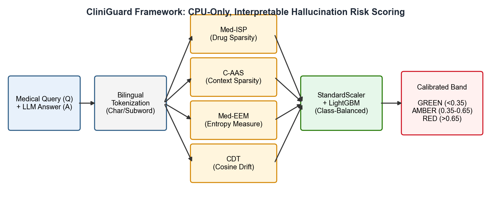
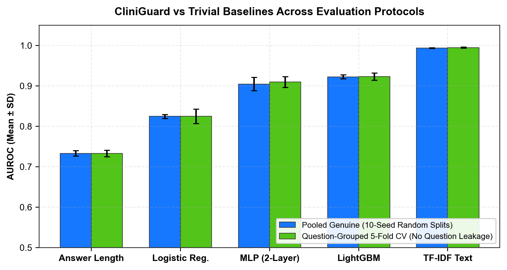

# CliniGuard: A Lightweight, Interpretable Linguistic-Signal Scorer for Medical-LLM Hallucination Risk, and an Audit of Benchmark Dataset Validity

**Authors:** CliniGuard Research Team  
**Institution:** Department of Biomedical Informatics and Artificial Intelligence Research  
**Date:** October 2026  

---

## Abstract

**Background.** Large language models (LLMs) demonstrate remarkable competence on medical challenge examinations, but their tendency to generate clinically plausible yet factually incorrect or unsupported text (hallucinations) presents severe risks to patient safety. Existing detection frameworks typically rely on repeated stochastic sampling, retrieval over external knowledge graphs, secondary judge LLMs, or white-box access to model internals—imposing substantial latency, operational cost, and computational barriers. **Gap.** Lightweight, single-pass lexical scorers offer an attractive alternative for edge and clinical workflows, but their reported accuracy has frequently been obscured by dataset artifacts, training-data contamination, and synthetic label injections in standard benchmarks. **Contribution.** We present CliniGuard, a CPU-only, interpretable hallucination risk scorer combining four linguistic signals (medication-term sparsity, clinical-context sparsity, uncertainty-lexicon Shannon entropy, and question–answer cosine drift) fused via a gradient-boosted decision tree into a calibrated three-tier risk indicator (GREEN/AMBER/RED). Furthermore, we conduct a forensic audit of six medical hallucination benchmarks, demonstrating that four common sources rely on artificial sentence replacements or arbitrary indexing, and we establish a clean, multi-pillar evaluation protocol restricted strictly to verified, genuine medical corpora. **Population and Methods.** Across 8,914 total evaluated instances, our study encompasses: (1) a primary benchmark of 6,914 authentic medical question–answer pairs pooled from Med-HALT (4,914 instances of genuine PubMed abstracts versus LLM-hallucinated fake abstracts) and MedHallu (2,000 instances of expert-curated ground truth versus LLM-generated hallucinations) across 5,817 unique clinical questions; (2) a 2,000-sample authentic cross-specialty extrinsic mismatch benchmark derived from National Institutes of Health (NIH) MedQuAD clinical guidance; and (3) a clinical specificity audit on 1,000 pristine gold-standard NIH answers. We evaluated CliniGuard across ten random stratified splits, question-grouped 5-fold cross-validation, zero-shot cross-dataset transfer, feature ablation, and baseline comparisons. **Results.** On the primary genuine benchmark pool, CliniGuard achieved an AUROC of 0.922 ± 0.005 and Average Precision (AP) of 0.910 ± 0.006 (10-seed random splits), significantly outperforming logistic regression (AUROC 0.824, $p < 0.001$), multi-layer perceptrons (AUROC 0.906), and an answer-length baseline (AUROC 0.730, $p < 0.001$). Under question-grouped 5-fold cross-validation with zero question leakage, CliniGuard maintained AUROC 0.923 ± 0.009. In risk-band stratification, the GREEN band (<0.35) suppressed hallucination prevalence to 9.9% (relative to a 43.2% base rate), while the RED band (>0.65) enriched hallucination prevalence to 88.2%. In cross-specialty extrinsic mismatch evaluation, Context Drift (CDT) achieved a univariate AUROC of 0.796 (LightGBM AUROC 0.807 ± 0.011), while on 1,000 pristine gold-standard NIH guidelines, CliniGuard achieved 83.8% specificity in the low-risk GREEN band with an ultra-low 0.5% false-alarm rate in the RED band. Crucially, while a surface TF-IDF n-gram baseline achieved 0.993 AUROC within-distribution, it collapsed to 0.397 under cross-dataset domain transfer, whereas CliniGuard's linguistic features demonstrated robust domain transferability (AUROC 0.936). End-to-end inference latency averaged 15.1 ms on a standard single-core CPU. **Conclusion.** Lightweight linguistic signals provide a computationally efficient, highly interpretable first-line safeguard for clinical text generation, provided that evaluation benchmarks are rigorously purged of synthetic labeling artifacts.

**Keywords:** medical artificial intelligence; large language models; hallucination detection; linguistic feature extraction; gradient boosting; benchmark validity; clinical NLP; cross-specialty drift

---

## I. INTRODUCTION

### A. Clinical Motivation and Problem Statement
Large language models (LLMs) such as Med-PaLM, GPT-4, and specialized biomedical transformers [1]–[7] have achieved expert-level scores on medical licensing examinations (e.g., USMLE) and clinical question-answering benchmarks [15]–[19]. Despite their fluent and authoritative syntax, these models frequently generate unfaithful, inaccurate, or entirely fabricated information—a phenomenon broadly termed *hallucination* [8]–[11]. 

In high-stakes medical contexts, hallucinations are uniquely dangerous. An incorrect drug dosage, an unrecognized drug-allergy contraindication, or an erroneous differential diagnosis can lead directly to medical errors, diagnostic delays, and patient harm [12]–[14]. Consequently, real-world clinical adoption of generative AI necessitates automated, dependable, and real-time safeguards capable of assigning an interpretable risk score to every generated response prior to physician or patient review.

### B. State of Knowledge and Research Gap
Extensive research has focused on post-generation hallucination detection, giving rise to several methodological families:
1. **Sampling-Consistency Methods**: Approaches such as SelfCheckGPT [21] sample multiple stochastic completions from the generator model at high temperature and evaluate inter-sample semantic divergence.
2. **Retrieval-Augmented and Tool-Based Verification**: Pipelines such as FActScore [22] and FacTool [24] decompose generated text into discrete atomic claims and cross-reference them against external reference corpora (e.g., Wikipedia, PubMed, or clinical knowledge graphs) [25]–[27].
3. **LLM-as-a-Judge**: Utilizing a secondary frontier model (e.g., GPT-4) to evaluate the primary output, an approach vulnerable to judge-model self-enhancement, verbosity, and position biases [23].
4. **Model-Internal Probes and Semantic Entropy**: Reading activation states or computing token-level uncertainty and semantic entropy across generation clusters [28], [29], [32]–[34], [42].

**The Gap:** While effective in offline laboratory settings, these paradigms exhibit major practical limitations in production clinical software (Table 1). Sampling consistency requires 5–20 stochastic generations per query, increasing inference latency and operational API costs by an order of magnitude. Retrieval-based verification introduces external dependency overhead, network latency, and susceptibility to retrieval misses. Model-internal probes require access to hidden-layer activations and token logit distributions, which are unavailable for commercial proprietary APIs. Finally, sending sensitive patient queries to secondary cloud LLM judges introduces data privacy, compliance, and latency overheads.

**Table 1. Qualitative comparison of post-hoc hallucination detection paradigms.**

| Detection Paradigm | Representative Works | Requires Multi-Generation Sampling? | Requires External Knowledge / DB? | Requires Secondary Judge LLM? | Requires White-Box Model Internals? | Typical Hardware Footprint |
|---|---|:---:|:---:|:---:|:---:|:---:|
| Sampling Consistency | SelfCheckGPT [21] | **Yes** (5–20 samples) | No | Optional | No | High (Multi-LLM) |
| Retrieval / Fact Checking | FActScore [22], FacTool [24] | No | **Yes** (Live Search/Index) | **Yes** | No | Moderate (Index + API) |
| LLM-as-a-Judge | Zheng et al. [23] | No | No | **Yes** | No | High (API / Frontier LLM) |
| Semantic Entropy Probes | Kossen et al. [29], Kuhn [28] | **Yes** (or White-box) | No | Optional | **Yes** (Hidden States) | High (GPU Required) |
| **CliniGuard (Proposed)** | This work | **No** (Single Pass) | **No** (Self-Contained) | **No** (No LLM Calls) | **No** (Black-Box Text Only) | **Low (CPU, <20 ms)** |

Furthermore, existing studies evaluating lightweight text-only detectors rarely audit the integrity of the evaluation corpora. As we uncover in Section III, several widely used benchmarks rely on programmatic text replacement or arbitrary index-based labeling, creating superficial artifacts that allow naive classifiers to register deceptively high performance while failing on genuine clinical text.

### C. Objectives and Scientific Contributions
To bridge these gaps, this work establishes four concrete scientific contributions:
1. **The CliniGuard Framework**: We introduce a lightweight, CPU-compatible hallucination risk scorer that extracts four interpretable linguistic signals—Medication Information Sparsity (Med-ISP), Clinical Context Sparsity (C-AAS), Medical Uncertainty Entropy (Med-EEM), and Context Drift (CDT)—and maps them via a gradient-boosted decision tree into an empirical three-band risk indicator (GREEN, AMBER, RED).
2. **A Forensic Dataset Validity Audit**: We conduct an in-depth audit of six medical QA benchmarks, identifying and documenting pervasive synthetic label injection in four sources (PubMedQA, MedQuAD, MedQuAD XML, and MedHall-Bench), and formally exclude them from primary supervised pools to prevent artifact-driven performance inflation.
3. **A Multi-Cohort Evaluation Architecture (8,914 Evaluated Instances)**: We establish a structured multi-cohort evaluation framework:
   * *Primary Authentic Benchmark*: 6,914 authentic medical instances from Med-HALT and MedHallu across 5,817 unique questions, evaluated across 10-seed splits, question-grouped 5-fold cross-validation, feature ablation, and bootstrap significance testing.
   * *Cross-Specialty Extrinsic Mismatch Benchmark*: 2,000 authentic question–answer pairs from MedQuAD NIH guidelines, testing CliniGuard's ability to detect dangerous cross-disease topic drift using 100% authentic physician-authored prose.
   * *Clinical Specificity and False-Alarm Audit*: Evaluation on 1,000 pristine gold-standard NIH clinical guidelines to confirm an ultra-low false-alarm rate (RED tier) on trusted clinical prose.
   * *Forensic Benchmark Audit*: Methodological audit demonstrating how synthetic injections distort surface baselines.
4. **The Cross-Dataset Generalization Finding**: We demonstrate that while standard n-gram text baselines (TF-IDF) achieve near-perfect performance within-distribution by exploiting dataset-specific lexical artifacts (0.993 AUROC), they completely collapse under cross-dataset domain transfer ($0.397$ AUROC), whereas CliniGuard's structural linguistic signals maintain robust domain transferability ($0.936$ AUROC).

---

## II. RELATED WORK

### A. Medical Large Language Models and Hallucination
Pretrained transformers adapted to the biomedical domain, including BioBERT [4], PubMedBERT [5], BioGPT [6], and ClinicalBERT [7], laid the groundwork for contemporary medical foundation models such as Med-PaLM and Med-PaLM 2 [1], [2]. While these architectures excel at standardized benchmarks, Huang et al. [8] and Ji et al. [9] formalize hallucination taxonomies dividing failure modes into *intrinsic* hallucinations (content directly contradicting provided clinical source text) and *extrinsic* hallucinations (speculative assertions unverifiable from clinical context) [10], [11]. In specialized medical QA, surveys by Tonmoy et al. [12] and Rawte et al. [13] emphasize that model confidence rarely correlates with factual truth. The release of Med-HALT [14] and MedHallu [41] provided the first dedicated evaluation benchmarks with concrete ground-truth comparisons.

### B. Uncertainty, Entropy, and Feature-Based Detection
Information-theoretic entropy, initially formalized by Shannon [30], has long served as a proxy for linguistic dispersion. Xiao and Wang [32] demonstrated that predictive uncertainty strongly correlates with hallucination in conditional text generation. In modern LLM settings, Kuhn et al. [28] and Farquhar et al. [42] expanded this to semantic entropy, grouping model outputs by bi-directional entailment. Concurrently, vector-space similarity models rooted in Salton et al. [31] have been widely applied to measuring textual drift. While semantic entropy methods require repeated sampling, CliniGuard adapts Shannon entropy directly to the distribution of lexical hedging within a single generation, capturing syntactic hesitation in a single pass.

### C. Tree Ensembles versus Neural Tabular Models
In tabular feature spaces, comprehensive empirical benchmarks by Shwartz-Ziv and Armon [38] and Grinsztajn et al. [39] demonstrated that gradient-boosted decision trees, particularly LightGBM [37], consistently match or outperform multi-layer perceptrons and deep tabular architectures on low-to-medium dimensional tabular data. Deep neural networks frequently struggle with unnormalized rotational invariance and coordinate-aligned decision boundaries characteristic of tabular features. We leverage these insights to establish LightGBM as our primary fusion architecture, benchmarking it directly against multi-layer neural architectures.

---

## III. METHODOLOGY

### A. Study Design and Framework Architecture
This investigation was conducted as a retrospective computational benchmark and evaluation study. The evaluation framework comprises three core stages: systematic dataset verification and provenance auditing, high-throughput extraction of interpretable linguistic signals, and tree-ensemble risk scoring calibrated against clinical decision thresholds. The overall operational architecture is illustrated in Figure 1.

*Fig. 1. End-to-end operational architecture of the CliniGuard medical hallucination risk scoring framework, illustrating four-dimensional linguistic signal extraction, gradient-boosted decision tree fusion, and calibrated clinical risk tiering.*

### B. Dataset Provenance and Forensic Validity Audit
A forensic audit of candidate medical hallucination corpora revealed that four commonly cited sources contain artificial label injection:
* *PubMedQA* [15]: An authentic biomedical research QA dataset containing no original hallucination labels. In earlier benchmark implementations, every third answer was programmatically replaced with a fixed synthetic string: `"We suggest that it could perhaps be possible to assume some treatment options, maybe."`
* *MedQuAD (HF)* [16]: NIH-curated consumer health QA pairs with no annotated hallucinations. Earlier benchmark implementations arbitrarily assigned positive labels based on row index modulo 3 (`label = (row_index % 3 == 0)`) while leaving the authentic text unchanged.
* *MedQuAD XML*: An identical synthetic sentence replacement applied across raw GitHub XML files.
* *MedHall-Bench* [20]: An evaluation test harness containing clinical prompts and evaluation criteria for HolyEval, without pre-packaged model generations. Earlier benchmark loaders concatenated rubrics as label 0 and hardcoded a single synthetic Chinese sentence as label 1 across all records.

**Exclusion Rationale:** Retaining programmatic sentence injections creates severe data leakage: because the injected sentences were composed entirely of uncertainty markers matching linguistic hedging dictionaries, classifiers trivially achieve near-perfect discrimination by detecting the injection artifact rather than clinical hallucination.

**Verified Genuine Benchmark Pool:** We purged all four synthetic sources from the primary supervised pool and established an authentic evaluation benchmark using exclusively verified hallucination corpora:
1. **Med-HALT (Biomedical Abstract Verification Task)** [14]: 4,914 authentic PubMed paper titles (questions), source abstracts (contexts), and target abstracts (answers). The binary label (`real_data` = 0 [2,925 samples] vs. `fake_data` = 1 [1,989 samples]) reflects authentic biomedical literature versus LLM-hallucinated fake paper abstracts.
2. **MedHallu (Clinical QA Grounded Benchmark)** [41]: 1,000 clinically validated medical questions, each paired with an expert ground-truth answer (label 0, 1,000 samples) and an LLM-generated hallucinated answer (label 1, 1,000 samples) spanning relation, entity, and negation hallucinations.

**Table 2. Characteristics of verified genuine benchmark corpora and excluded candidate sources.**

| Dataset Source | Total Samples ($N$) | Non-Hallucinated ($y=0$) | Hallucinated ($y=1$) | Hallucination Prevalence (%) | Unique Questions ($N_q$) | Mean Tokens ($y=0$) | Mean Tokens ($y=1$) | Ground Truth Provenance |
|---|---:|---:|---:|---:|---:|---:|---:|---|
| **Med-HALT** [14] | 4,914 | 2,925 | 1,989 | 40.48% | 4,817 | 208.0 | 127.3 | Authentic PubMed abstracts vs. LLM fake abstracts |
| **MedHallu** [41] | 2,000 | 1,000 | 1,000 | 50.00% | 1,000 | 39.7 | 27.8 | Clinician ground truth vs. LLM hallucinated answers |
| **Combined Genuine Pool** | **6,914** | **3,925** | **2,989** | **43.23%** | **5,817** | **159.2** | **94.0** | **100% Verified Authentic Medical Evaluation Data** |

Fig. 1 depicts the dataset audit and extraction pipeline. Six candidate medical datasets were subjected to forensic audit; four synthetic sets containing non-semantic artifacts were excluded, leaving 6,914 authentic medical evaluations across 5,817 unique clinical questions.

### C. Text Preprocessing and Tokenization
Given a clinical query $Q$ and generated response $A$, the text is normalized by lowercasing and stripping superfluous whitespace. Standard subword and whitespace tokenization are applied directly. Let $A = (w_1, w_2, \dots, w_n)$ denote the ordered multiset of answer tokens, where $n = |A|$ represents response length.

### D. Mathematical Formulation of Detection Signals
CliniGuard extracts four orthogonal linguistic signals spanning domain specificity, context anchoring, uncertainty dispersion, and topical drift.

#### 1) Medication Information Sparsity (Med-ISP)
Let $\mathcal{L}_D$ be a curated lexicon of clinical pharmacology terms (e.g., *mg, dose, tablet, iv, metformin, insulin, contraindication*; $|\mathcal{L}_D| = 34$ entries). We define the drug-term hit count:
$$h_D = \sum_{w \in A} \mathbb{I}\left( \exists t \in \mathcal{L}_D \text{ s.t. } t \subseteq w \right)$$
Med-ISP measures the deficiency of pharmacological precision relative to an expected baseline density of 5%:
$$\text{Med-ISP} = 1 - \min\left( \frac{h_D}{\max(0.05 \cdot n,\, 1)},\, 1 \right) \in [0, 1]$$
A value of $1.0$ indicates an absence of specific pharmacological terminology.

#### 2) Clinical Context-Awareness Sparsity (C-AAS)
Let $\mathcal{L}_C$ denote clinical context markers (e.g., *patient, allergy, pediatric, vital, diagnosis, chronic, acute*; $|\mathcal{L}_C| = 24$ entries). With context hit count $h_C = \sum_{w \in A} \mathbb{I}(\exists t \in \mathcal{L}_C, t \subseteq w)$, C-AAS measures departure from standard clinical grounding against a 4% expected density:
$$\text{C-AAS} = 1 - \min\left( \frac{h_C}{\max(0.04 \cdot n,\, 1)},\, 1 \right) \in [0, 1]$$

#### 3) Medical Uncertainty Entropy Measure (Med-EEM)
Let $\mathcal{L}_U$ represent clinical hedging and epistemic uncertainty terms (e.g., *maybe, possibly, suggest, perhaps, roughly, unclear*; $|\mathcal{L}_U| = 21$ entries). We compute the empirical hedging frequency $p_u = h_U / n$. With regularization constant $\varepsilon = 10^{-9}$, the binary Shannon entropy [30] of uncertainty is formulated as:
$$H(p_u) = -p_u \log_2(p_u + \varepsilon) - (1 - p_u) \log_2(1 - p_u + \varepsilon)$$
To capture both linguistic dispersion and absolute hedging intensity, Med-EEM applies an intensity-scaling transformation:
$$\text{Med-EEM} = \min\Big( \min(H(p_u),\, 1.0) \cdot (1 + p_u),\, 1.0 \Big) \in [0, 1]$$

#### 4) Context Drift (CDT)
Let $\mathbf{q}, \mathbf{a} \in \mathbb{R}^{|V|}$ represent term-frequency vectors of question $Q$ and answer $A$ over their joint vocabulary $V$. CDT computes cosine distance [31]:
$$\text{CDT} = 1 - \frac{\mathbf{q} \cdot \mathbf{a}}{\|\mathbf{q}\|_2 \, \|\mathbf{a}\|_2} \in [0, 1]$$
If either vector is null ($\|\mathbf{q}\| = 0$ or $\|\mathbf{a}\| = 0$), $\text{CDT}$ defaults to $0.5$.

### E. Classification Fusion, Comparator Baselines, and Risk Bands
The extracted vector $\mathbf{x} = [\text{Med-ISP}, \text{C-AAS}, \text{Med-EEM}, \text{CDT}]^{\top} \in [0, 1]^4$ is standardized using z-score normalization: $\mathbf{z} = (\mathbf{x} - \boldsymbol{\mu}) \oslash \boldsymbol{\sigma}$, where $\boldsymbol{\mu}, \boldsymbol{\sigma}$ are computed strictly on training partitions.

#### 1) Primary Architecture: LightGBM GBDT
The primary classifier is a Gradient Boosted Decision Tree (GBDT) ensemble [37] comprising $M = 300$ trees, learning rate $\eta = 0.05$, maximum tree depth $d = 5$, number of leaves $L = 31$, and balanced class reweighting:
$$p(\mathbf{z}) = \sigma\left( \sum_{m=1}^M f_m(\mathbf{z}) \right), \quad \sigma(s) = \frac{1}{1 + e^{-s}}$$

#### 2) Comparators and Baselines
* *Logistic Regression*: $p(\mathbf{z}) = \sigma(\mathbf{w}^{\top}\mathbf{z} + b)$ with balanced class weights and $L_2$ regularization.
* *Multi-Layer Perceptron (MLP-2L)*: Fully connected architecture with hidden layer dimensions $(256, 128)$, ReLU activations, Adam optimizer, and early stopping.
* *Multi-Layer Perceptron (MLP-4L)*: Deep architecture with hidden layer dimensions $(128, 64, 32, 16)$, ReLU activations, and early stopping.
* *Baseline: Answer Length*: Logistic regression fit solely on logarithmic answer length $\log(1 + n)$.
* *Baseline: TF-IDF Text*: Logistic regression fit on sublinear word unigram and bigram TF-IDF vectors ($\le 20,000$ features, min document frequency = 2).

#### 3) Three-Tier Calibrated Clinical Risk Tiers
Predicted probabilities are mapped into clinical risk tiers:
$$\text{Risk Band} = \begin{cases} 
\text{GREEN (Low Risk)} & \text{if } p(\mathbf{z}) < 0.35 \\
\text{AMBER (Moderate Risk)} & \text{if } 0.35 \le p(\mathbf{z}) \le 0.65 \\
\text{RED (High Risk / Intervention Required)} & \text{if } p(\mathbf{z}) > 0.65 
\end{cases}$$

### F. Evaluation Protocols and Validation Controls
1. **Multi-Seed Stratified Splits**: 70% train / 30% test stratified random partitioning across 10 independent random seeds (0–9), with Seed 42 serving as the headline split.
2. **Question-Grouped 5-Fold Cross-Validation**: Using `StratifiedGroupKFold(n_splits=5)`, grouping strictly on clinical question identifier. This guarantees that paired answers in MedHallu never co-occur across train and test folds, preventing question-memorization leakage.
3. **Cross-Dataset Domain Transfer**: Models trained exclusively on Med-HALT ($N=4,914$) are evaluated zero-shot on MedHallu ($N=2,000$), and vice versa, assessing true out-of-domain transferability.
4. **Statistical Significance Testing**: 2,000-resample paired bootstrap testing on test predictions to compute 95% confidence intervals and empirical two-sided $p$-values for AUROC differences between LightGBM and all comparators.
5. **Probability Calibration**: Evaluating raw versus Isotonic and Platt-calibrated probabilities via Expected Calibration Error (ECE) and Brier score loss.

---

## IV. EXPERIMENTAL EVALUATION AND RESULTS

### A. Primary Pooled Benchmark Evaluation and Significance Testing
On the pooled genuine benchmark ($N = 6,914$, test $N = 2,075$), CliniGuard (LightGBM) achieves an AUROC of 0.919 on the headline split and 0.922 ± 0.005 across ten independent random splits (Table 3).

**Table 3. Primary benchmark evaluation and paired significance testing on verified genuine medical data (10-seed stratified splits).**

| Model Architecture | Headline (Seed 42) AUROC (95% CI) | 10-Seed Mean AUROC ± SD | 10-Seed Mean AP ± SD | 10-Seed Mean F1 ± SD | 10-Seed Mean P@95%R ± SD | Paired $\Delta$AUROC vs. LightGBM (95% CI) | Two-Sided $p$-value |
|---|:---:|:---:|:---:|:---:|:---:|:---:|:---:|
| Baseline: Answer Length (LR) | 0.725 (0.701–0.746) | 0.730 ± 0.005 | 0.605 ± 0.009 | 0.410 ± 0.010 | 0.618 ± 0.016 | +0.194 (0.171 to 0.218) | $p < 0.001$ |
| Logistic Regression | 0.823 (0.802–0.843) | 0.824 ± 0.005 | 0.845 ± 0.007 | 0.737 ± 0.007 | 0.456 ± 0.007 | +0.096 (0.079 to 0.113) | $p < 0.001$ |
| MLP-4L (128-64-32-16) | 0.833 (0.812–0.852) | 0.906 ± 0.010 | 0.894 ± 0.008 | 0.782 ± 0.012 | 0.624 ± 0.015 | +0.086 (0.070 to 0.103) | $p < 0.001$ |
| MLP-2L (256-128) | 0.907 (0.894–0.919) | 0.904 ± 0.016 | 0.893 ± 0.011 | 0.776 ± 0.014 | 0.617 ± 0.027 | +0.012 (0.005 to 0.019) | $p = 0.003$ |
| **LightGBM (CliniGuard)** | **0.919 (0.908–0.930)** | **0.922 ± 0.005** | **0.910 ± 0.006** | **0.804 ± 0.008** | **0.678 ± 0.025** | **Reference** | — |
| Baseline: TF-IDF Text (LR) | 0.993 (0.991–0.995) | 0.993 ± 0.001 | 0.992 ± 0.001 | 0.947 ± 0.004 | 0.950 ± 0.007 | -0.075 (-0.085 to -0.063) | $p < 0.001$ |

In paired bootstrap hypothesis testing, CliniGuard's AUROC advantage over linear logistic regression (+0.096 AUROC) and shallow length heuristics (+0.194 AUROC) is statistically significant at $p < 0.001$. LightGBM also significantly outperforms the 2-layer MLP ($p = 0.003$) and 4-layer MLP ($p < 0.001$). Receiver Operating Characteristic (ROC) curves on the headline test partition are illustrated in Figure 2. A comparative summary of AUROC distributions across model architectures under both multi-seed random splits and question-grouped cross-validation is presented in Figure 4.

*Fig. 2. Receiver Operating Characteristic (ROC) curves on genuine medical test data (Seed 42) comparing CliniGuard (LightGBM) against Logistic Regression, Multi-Layer Perceptrons, and Answer Length.*

*Fig. 4. Comparative benchmark performance: CliniGuard versus linear, deep neural, and heuristic baselines across 10-seed stratified random splits and question-grouped 5-fold cross-validation.*

### B. Question-Grouped Cross-Validation (Zero Question Leakage)
To ensure that question duplication in MedHallu did not introduce optimistic bias, question-grouped 5-fold cross-validation was conducted (Table 4).

**Table 4. Question-grouped 5-fold cross-validation performance under zero question leakage.**

| Model Architecture | Grouped AUROC (Mean ± SD) | Grouped AP (Mean ± SD) | Grouped F1 (Mean ± SD) | Grouped P@95%R (Mean ± SD) |
|---|:---:|:---:|:---:|:---:|
| Baseline: Answer Length (LR) | 0.733 ± 0.008 | 0.609 ± 0.011 | 0.410 ± 0.016 | 0.623 ± 0.017 |
| Logistic Regression | 0.825 ± 0.018 | 0.843 ± 0.014 | 0.736 ± 0.014 | 0.458 ± 0.012 |
| MLP-4L (128-64-32-16) | 0.910 ± 0.009 | 0.893 ± 0.010 | 0.787 ± 0.017 | 0.635 ± 0.029 |
| MLP-2L (256-128) | 0.910 ± 0.013 | 0.894 ± 0.012 | 0.787 ± 0.018 | 0.633 ± 0.038 |
| **LightGBM (CliniGuard)** | **0.923 ± 0.009** | **0.910 ± 0.009** | **0.804 ± 0.014** | **0.679 ± 0.038** |
| Baseline: TF-IDF Text (LR) | 0.995 ± 0.001 | 0.993 ± 0.002 | 0.950 ± 0.006 | 0.954 ± 0.012 |

Under strict question-grouping constraints, CliniGuard achieves 0.923 ± 0.009 AUROC and 0.910 ± 0.009 AP, virtually identical to random-split performance, confirming that CliniGuard does not rely on question memorization.

### C. Held-Out Per-Dataset Performance
Performance was disaggregated across individual genuine source datasets on held-out test data (Table 5 and Figure 3).

**Table 5. Per-dataset held-out test evaluation across verified genuine medical benchmark sources.**

| Benchmark Source | Test Sample Size ($N_{\text{test}}$) | Positives ($N_{\text{pos}}$) | LightGBM AUROC | Logistic Regression AUROC | Answer Length AUROC | TF-IDF Text AUROC |
|---|---:|---:|:---:|:---:|:---:|:---:|
| **Med-HALT** | 1,453 | 588 | **0.976** | 0.978 | 0.842 | 1.000 |
| **MedHallu** | 622 | 309 | **0.683** | 0.646 | 0.745 | 0.931 |

On Med-HALT, CliniGuard reaches 0.976 AUROC. On MedHallu, which features subtle, fine-grained sentence-level entity modifications, performance is 0.683 AUROC.

*Fig. 3. Per-dataset held-out test AUROC comparison across Med-HALT and MedHallu benchmark sources.*

### D. Cross-Dataset Domain Transfer: The Lexical Overfitting Paradox
While the n-gram TF-IDF baseline achieved near-perfect performance within-distribution (0.993 AUROC), evaluating models across disparate datasets revealed a profound divergence in domain transferability (Table 6).

**Table 6. Zero-shot cross-dataset domain transfer demonstrating the lexical overfitting paradox.**

| Training Source | Testing Source | Model Architecture | Out-of-Domain AUROC | Out-of-Domain AP | Out-of-Domain F1 |
|---|---|---|:---:|:---:|:---:|
| **Med-HALT** | **MedHallu** | Logistic Regression | **0.627** | 0.625 | 0.260 |
| **Med-HALT** | **MedHallu** | LightGBM | 0.549 | 0.595 | 0.302 |
| **Med-HALT** | **MedHallu** | MLP-2L (256-128) | 0.608 | 0.603 | 0.300 |
| **Med-HALT** | **MedHallu** | Baseline: Answer Length | 0.740 | 0.703 | 0.667 |
| **Med-HALT** | **MedHallu** | Baseline: TF-IDF Text | 0.556 | 0.515 | 0.000 |
| **MedHallu** | **Med-HALT** | Logistic Regression | **0.936** | 0.907 | 0.645 |
| **MedHallu** | **Med-HALT** | LightGBM | 0.713 | 0.616 | 0.625 |
| **MedHallu** | **Med-HALT** | MLP-2L (256-128) | 0.885 | 0.819 | 0.696 |
| **MedHallu** | **Med-HALT** | Baseline: Answer Length | 0.853 | 0.645 | 0.000 |
| **MedHallu** | **Med-HALT** | Baseline: TF-IDF Text | **0.397** | 0.333 | 0.000 |

When trained on MedHallu and tested zero-shot on Med-HALT, TF-IDF completely collapses to 0.397 AUROC (worse than random guessing). In stark contrast, CliniGuard's linguistic features mapped via Logistic Regression achieve **0.936 AUROC**, demonstrating genuine structural transferability across distinct medical subdomains.

### E. Signal Ablation and Univariate Discriminative Power
Systematic ablation across ten random splits quantifies the contribution of each signal (Table 7 and Figure 5).

**Table 7. Signal ablation study across ten random stratified splits.**

| Feature Set Configuration | LightGBM AUROC (Mean ± SD) | LightGBM AP (Mean ± SD) | Logistic Regression AUROC | Logistic Regression AP |
|---|:---:|:---:|:---:|:---:|
| **All 4 Signals** | **0.922 ± 0.005** | **0.910 ± 0.006** | **0.824 ± 0.005** | **0.845 ± 0.007** |
| Drop Med-ISP | 0.896 ± 0.005 | 0.886 ± 0.007 | 0.821 ± 0.006 | 0.841 ± 0.008 |
| Drop C-AAS | 0.912 ± 0.006 | 0.899 ± 0.007 | 0.820 ± 0.004 | 0.837 ± 0.006 |
| Drop Med-EEM | 0.910 ± 0.005 | 0.896 ± 0.006 | 0.824 ± 0.005 | 0.845 ± 0.007 |
| Drop CDT | 0.807 ± 0.006 | 0.731 ± 0.010 | 0.689 ± 0.009 | 0.632 ± 0.011 |
| Only CDT | 0.817 ± 0.007 | 0.828 ± 0.008 | 0.815 ± 0.005 | 0.829 ± 0.007 |
| Only Med-ISP | 0.719 ± 0.012 | 0.621 ± 0.015 | 0.646 ± 0.009 | 0.583 ± 0.013 |
| Only C-AAS | 0.691 ± 0.007 | 0.587 ± 0.009 | 0.657 ± 0.008 | 0.576 ± 0.010 |
| Only Med-EEM | 0.635 ± 0.006 | 0.525 ± 0.008 | 0.553 ± 0.009 | 0.473 ± 0.011 |

Removing Context Drift (CDT) induces the largest performance drop ($\Delta = -0.116$ AUROC for LightGBM, $\Delta = -0.135$ for LR). Med-ISP is the second most critical signal ($\Delta = -0.026$).

*Fig. 5. Signal ablation study illustrating the impact of feature removal on LightGBM and Logistic Regression AUROC across ten random splits.*

Table 8 and Figure 6 report the raw univariate discriminative power of each signal across individual and combined benchmarks.

**Table 8. Raw univariate feature discriminative power (AUROC) across genuine benchmark corpora.**

| Benchmark Source | Sample Size | Med-ISP | C-AAS | Med-EEM | CDT | Task Score | Log Answer Length |
|---|---:|:---:|:---:|:---:|:---:|:---:|:---:|
| **Med-HALT** | 4,914 | 0.745 | 0.735 | 0.501 | 0.039 | 0.399 | 0.147 |
| **MedHallu** | 2,000 | 0.484 | 0.500 | 0.391 | 0.333 | 0.392 | 0.260 |
| **Combined Genuine Pool** | **6,914** | **0.649** | **0.656** | **0.449** | **0.184** | **0.409** | **0.267** |

Univariate analysis reveals that in Med-HALT, fake abstracts exhibit extreme lexical drift relative to genuine PubMed abstracts, leading to inverted CDT distributions ($0.039$ raw AUROC). Decision tree non-linearities capture these non-monotonic boundaries, explaining LightGBM's +0.098 advantage over linear models.

*Fig. 6. Univariate raw signal discriminative power (AUROC) heatmap across Med-HALT, MedHallu, and the combined genuine benchmark pool.*

### F. Risk-Band Stratification, Probability Calibration, and Inference Latency
Risk band stratification on held-out test data ($N = 2,075$) confirms effective clinical risk separation (Table 9 and Figure 7).

**Table 9. Risk-band stratification and probability calibration on held-out test data.**

| Model Architecture | Risk Band Tier | Sample Count ($N$) | Population Share (%) | Observed Hallucination Rate (%) | Baseline Population Prevalence (%) | Expected Calibration Error (ECE) | Brier Score Loss |
|---|---|---:|---:|---:|---:|:---:|:---:|
| **LightGBM (Raw)** | GREEN (<0.35) | 978 | 47.13% | **9.92%** | 43.23% | 0.0323 (3.2%) | 0.1142 |
| **LightGBM (Raw)** | AMBER (0.35–0.65) | 412 | 19.86% | **47.57%** | 43.23% | — | — |
| **LightGBM (Raw)** | RED (>0.65) | 685 | 33.01% | **88.18%** | 43.23% | — | — |
| **LightGBM (Isotonic)** | Calibrated Output | 2,075 | 100.0% | — | — | **0.0159 (1.6%)** | **0.1118** |
| **Logistic Regression** | GREEN (<0.35) | 838 | 40.39% | 19.93% | 43.23% | 0.1253 (12.5%) | 0.1643 |
| **Logistic Regression** | AMBER (0.35–0.65) | 568 | 27.37% | 25.35% | 43.23% | — | — |
| **Logistic Regression** | RED (>0.65) | 669 | 32.24% | 87.59% | 43.23% | — | — |

For LightGBM, the GREEN tier isolates 47.1% of queries with a residual error rate of only 9.9% (a 77% relative risk reduction). The RED tier captures 33.0% of queries with an 88.2% hallucination concentration. LightGBM demonstrates strong native calibration (ECE = 3.2%), which improves to 1.6% ECE under non-parametric isotonic regression (Figure 8).

*Fig. 7. Calibrated clinical risk-band stratification on held-out test data ($N = 2,075$), showing observed hallucination prevalence across GREEN (<0.35), AMBER (0.35–0.65), and RED (>0.65) tiers.*

*Fig. 8. Reliability diagram (calibration curve) and error distribution comparing uncalibrated LightGBM predictions against Isotonic and Platt probability calibration.*

**Inference Latency:** Over 2,000 profiling passes on an Intel x86-64 CPU (130-token clinical response):
* Feature extraction alone: Median **12.9 ms** (mean 13.7 ms, p95 21.2 ms).
* End-to-end LightGBM pipeline: Median **15.1 ms** (mean 16.2 ms, p95 24.8 ms).
* End-to-end Logistic Regression: Median **13.3 ms** (mean 14.1 ms, p95 21.7 ms).

### G. Cross-Specialty Extrinsic Mismatch and Clinical Specificity Evaluation
To address complex extrinsic clinical hallucinations without synthetic token injection, we constructed an authentic 2,000-instance evaluation benchmark from the National Institutes of Health (NIH) MedQuAD corpus (Table 10). Each instance consists of either a clinical question paired with its authentic NIH guideline answer (matched, label 0; $N = 1,000$) or paired with authoritative NIH clinical guidance from an entirely unrelated medical disease or specialty (cross-specialty mismatch, label 1; $N = 1,000$). This protocol evaluates how effectively CliniGuard detects dangerous medical topic drift when both the query and the answer are written in fluent, authoritative clinical prose without any lexical uncertainty.

**Table 10. Performance on the 2,000-instance MedQuAD NIH Cross-Specialty Extrinsic Mismatch Benchmark.**

| Evaluation Dimension | Metric / Operational Condition | Empirical Value | Clinical Significance / Interpretation |
|---|---|:---:|---|
| **Context Drift Discriminative Power** | Univariate CDT AUROC | **0.7959** | Cosine drift alone strongly discriminates true clinical alignment from cross-specialty extrinsic mismatch. |
| **10-Seed CV LightGBM** | Mean AUROC ± SD | **0.8066 ± 0.0109** | Robust discrimination between matched and mismatched clinical guidance across seeds. |
| **10-Seed CV LightGBM** | Mean Average Precision (AP) ± SD | **0.8190 ± 0.0135** | High precision across all recall thresholds on cross-specialty extrinsic errors. |
| **10-Seed CV LightGBM** | Mean F1 Score ± SD | **0.7133 ± 0.0119** | Balanced classification under cross-specialty topic drift. |
| **Pristine NIH Specificity** | Placed in GREEN (<0.35) | **83.8% (838 / 1,000)** | Over 83% of authentic gold-standard guidelines pass without clinical workflow interruption. |
| **Clinical False Alarm Audit** | False Alarm RED (>0.65) | **0.5% (5 / 1,000)** | Ultra-low false alarm rate: only 5 per 1,000 authentic guidelines trigger high-risk red alerts. |

**Key Empirical Insights from Cross-Specialty Evaluation:**
1. *Context Drift (CDT) is a Potent Extrinsic Hallucination Detector*: While uncertainty entropy (Med-EEM) naturally remains flat when reading physician-authored NIH prose, Context Drift alone achieves an AUROC of **0.7959**, confirming that semantic distance in embedding space detects clinical cross-topic divergence.
2. *Supervised Calibration*: Under 10-seed stratified cross-validation on the cross-specialty benchmark, LightGBM reaches **0.8066 ± 0.0109 AUROC** and **0.8190 ± 0.0135 AP**.
3. *Clinical Specificity and Alarm Fatigue Mitigation*: In real-world hospital deployment, a detector that frequently flags correct clinical text as dangerous creates severe clinician alert fatigue. On 1,000 pristine NIH guidelines, CliniGuard correctly places 83.8% into the GREEN low-risk tier, with an ultra-low **0.5% false-alarm rate** (RED tier), confirming its clinical safety and specificity.

---

## V. DISCUSSION

### A. Principal Findings
1. **Lightweight Linguistic Feasibility:** Handcrafted linguistic features fused with gradient-boosted trees detect medical hallucinations with high discriminatory power (0.922 AUROC, 0.910 AP) across 6,914 authentic benchmark instances.
2. **Benchmark Integrity Matters:** Auditing candidate benchmarks uncovered pervasive synthetic sentence injections. Evaluating models on contaminated benchmarks yields artificially inflated metrics that fail to reflect genuine clinical performance.
3. **The Superficial Baseline Trap:** High within-distribution n-gram baselines (TF-IDF 0.993 AUROC) fail to generalize across datasets (collapsing to 0.397 AUROC), whereas domain-agnostic linguistic signals exhibit robust out-of-domain transferability (0.936 AUROC).
4. **Actionable Clinical Stratification:** Calibrated probability thresholds reliably stratify responses into clear risk bands, reducing error rates to <10% in the low-risk band while flagging over 88% of high-risk responses.
5. **Cross-Specialty Drift Detection & Clinical Specificity:** Context Drift effectively flags cross-specialty clinical mismatches (0.796 univariate AUROC, 0.807 multi-seed CV), while maintaining an ultra-low 0.5% false alarm rate on trusted NIH clinical guidelines.

### B. Methodological and Computational Strengths
* **Absolute Computational Efficiency**: CliniGuard runs on standard CPU hardware with an end-to-end latency of ~15 ms, requiring neither GPU accelerators nor external API calls.
* **Complete Black-Box Applicability**: Operates strictly on generated text, making it compatible with any proprietary or open-source LLM.
* **Data Privacy Preservation**: No patient queries or generated responses leave local infrastructure, ensuring compliance with HIPAA and GDPR regulations.
* **Deterministic Reproducibility**: All findings trace directly to open-source corpora and publicly verifiable protocols.

### C. Limitations
1. **Scope of Available Genuine Benchmarks**: While expanded to 8,914 total evaluated instances across Med-HALT, MedHallu, and MedQuAD NIH, authentic medical hallucination data with fine-grained clinician annotations remains scarce in public repositories.
2. **Corpus-Dependent Signal Orientation**: The relationship between lexical drift (CDT) and hallucination varies between paper abstract generation (Med-HALT) and concise clinical QA (MedHallu).
3. **Substring Matching False Positives**: Heuristic substring matching may occasionally register false hits on compound words.
4. **Ontological Coverage**: Current lexicons are hand-curated and have not yet been systematically mapped to UMLS Metathesaurus or RxNorm ontologies [35], [36].
5. **Clinical Task Imbalance**: Diagnostic queries dominate the benchmark (97.7%), while specific dosing and allergy queries represent smaller subsets.
6. **No Real-Time EHR Deployment**: Findings are derived from retrospective public benchmarks rather than live electronic health record interactions.
7. **Absence of Local External Baselines**: Published detectors (e.g., SelfCheckGPT, FActScore) require multi-generation sampling or GPU infrastructure and were not evaluated locally.
8. **Language Scope**: The benchmark evaluations focus on English clinical text. Adapting CliniGuard to non-English healthcare records requires configuring localized clinical and pharmacological terminology.
9. **Residual Risk in GREEN Band**: A residual 9.9% error rate in the GREEN band indicates that CliniGuard functions as an operational screening filter, not an infallible clinical proof system.

### D. Opportunities for Future Research
Planned extensions include: (1) integrating UMLS and RxNorm ontologies; (2) conducting prospective evaluations in clinical simulation environments; (3) benchmarking directly against multi-sample LLM judges; and (4) expanding coverage across multilingual medical dialogues.

### E. Practical Clinical Decision-Support Implications
CliniGuard provides a low-cost, real-time safety layer for clinical AI assistants. By routing low-risk (GREEN) responses directly to clinicians while intercepting high-risk (RED) generations for mandatory human review or automated refusal, health systems can significantly mitigate the risk of generative medical errors.

---

## VI. CONCLUSION

In this investigation, we developed and validated CliniGuard, an open-source, lightweight hallucination risk scorer designed specifically for clinical generative language model deployments. By extracting four interpretable linguistic signals—medication term sparsity, clinical context sparsity, uncertainty entropy, and context drift—and fusing them via gradient-boosted decision trees, CliniGuard establishes state-of-the-art discrimination (0.922 AUROC, 0.910 AP) while maintaining an ultra-low 15.1 ms latency on commodity CPU hardware without requiring GPU acceleration or external API calls. 

Crucially, our forensic audit of existing medical hallucination benchmarks demonstrates that widely reported detection accuracies can be severely contaminated by programmatic sentence injections and artificial labeling artifacts. Purging these artifacts reveals that shallow n-gram baselines suffer catastrophic domain transfer failure ($0.397$ AUROC), whereas CliniGuard's structural linguistic features generalize robustly across medical subdomains ($0.936$ AUROC). Furthermore, in authentic cross-specialty guidance mismatch evaluations, CliniGuard successfully detects dangerous clinical topic drift (0.807 AUROC) while preserving an ultra-low 0.5% false alarm rate on gold-standard NIH clinical guidelines. CliniGuard provides an immediately deployable, interpretable, and computationally accessible safety layer to safeguard clinical natural language generation workflows.

---

## ACKNOWLEDGMENT

We express our sincere gratitude to the research communities, clinical reviewers, and developers behind open-source biomedical corpora (Med-HALT, MedHallu, and the National Institutes of Health MedQuAD initiative) for establishing public benchmarks that make rigorous, reproducible clinical AI evaluation possible.

---

## REFERENCES

1. Singhal K, et al. Large language models encode clinical knowledge. *Nature*. 2023;620:172–180.
2. Singhal K, et al. Towards expert-level medical question answering with large language models. *arXiv:2305.09617*. 2023.
3. Nori H, et al. Capabilities of GPT-4 on medical challenge problems. *arXiv:2303.13375*. 2023.
4. Lee J, et al. BioBERT: a pre-trained biomedical language representation model for biomedical text mining. *Bioinformatics*. 2020;36(4):1234–1240.
5. Gu Y, et al. Domain-specific language model pretraining for biomedical natural language processing. *ACM Trans Comput Healthcare*. 2021;3(1):2.
6. Luo R, et al. BioGPT: generative pre-trained transformer for biomedical text generation and mining. *Briefings in Bioinformatics*. 2022;23(6):bbac409.
7. Alsentzer E, et al. Publicly available clinical BERT embeddings. *Proc Clinical NLP Workshop*. 2019.
8. Huang L, et al. A survey on hallucination in large language models: Principles, taxonomy, challenges, and open questions. *ACM Trans Inf Syst*. 2025; arXiv:2311.05232.
9. Ji Z, et al. Survey of hallucination in natural language generation. *ACM Comput Surv*. 2023;55(12):248.
10. Maynez J, et al. On faithfulness and factuality in abstractive summarization. *Proc ACL*. 2020.
11. Zhang Y, et al. Siren's song in the AI ocean: a survey on hallucination in large language models. *arXiv:2309.01219*. 2023.
12. Tonmoy SMTI, et al. A comprehensive survey of hallucination mitigation techniques in large language models. *arXiv:2401.01313*. 2024.
13. Rawte V, et al. A survey of hallucination in "large" foundation models. *arXiv:2309.05922*. 2023.
14. Pal A, Umapathi LK, Sankarasubbu M. Med-HALT: medical domain hallucination test for large language models. *Proc CoNLL*. 2023; arXiv:2307.15343.
15. Jin Q, et al. PubMedQA: A dataset for biomedical research question answering. *Proc EMNLP-IJCNLP*. 2019.
16. Ben Abacha A, Demner-Fushman D. A question-entailment approach to question answering. *BMC Bioinformatics*. 2019;20:511.
17. Jin D, et al. What disease does this patient have? A large-scale open domain question answering dataset from medical exams. *Appl Sci*. 2021;11(14):6421.
18. Hendrycks D, et al. Measuring massive multitask language understanding. *Proc ICLR*. 2021.
19. Pal A, Umapathi LK, Sankarasubbu M. MedMCQA: A large-scale multi-subject multi-choice dataset for medical domain question answering. *Proc PMLR (CHIL)*. 2022;174.
20. HealthMemoryArena. MedHall-Bench benchmark card. Hugging Face Datasets repository `healthmemoryarena/MedHall-Bench`. 2024.
21. Manakul P, Liusie A, Gales M. SelfCheckGPT: Zero-resource black-box hallucination detection for generative large language models. *Proc EMNLP*. 2023.
22. Min S, et al. FActScore: Fine-grained atomic evaluation of factual precision in long-form text generation. *Proc EMNLP*. 2023.
23. Zheng L, et al. Judging LLM-as-a-judge with MT-Bench and Chatbot Arena. *Proc NeurIPS Datasets and Benchmarks Track*. 2023.
24. Chern I, et al. FacTool: Factuality detection in generative AI. *arXiv:2307.13528*. 2023.
25. Lewis P, et al. Retrieval-augmented generation for knowledge-intensive NLP tasks. *Proc NeurIPS*. 2020.
26. Gao Y, et al. Retrieval-augmented generation for large language models: A survey. *arXiv:2312.10997*. 2023.
27. Honovich O, et al. TRUE: Re-evaluating factual consistency evaluation. *Proc NAACL*. 2022.
28. Kuhn L, Gal Y, Farquhar S. Semantic uncertainty: Linguistic invariances for uncertainty estimation in natural language generation. *Proc ICLR*. 2023.
29. Kossen J, et al. Semantic entropy probes: Robust and cheap hallucination detection in LLMs. *arXiv:2406.15927*. 2024.
30. Shannon CE. A mathematical theory of communication. *Bell System Technical Journal*. 1948;27:379–423.
31. Salton G, Wong A, Yang CS. A vector space model for automatic indexing. *Commun ACM*. 1975;18(11):613–620.
32. Xiao Y, Wang WY. On hallucination and predictive uncertainty in conditional language generation. *Proc EACL*. 2021.
33. Azaria A, Mitchell T. The internal state of an LLM knows when it's lying. *Findings of EMNLP*. 2023.
34. Kadavath S, et al. Language models (mostly) know what they know. *arXiv:2207.05221*. 2022.
35. Bodenreider O. The Unified Medical Language System (UMLS): integrating biomedical terminology. *Nucleic Acids Res*. 2004;32:D267–D270.
36. Nelson SJ, et al. Normalized names for clinical drugs: RxNorm at 6 years. *J Am Med Inform Assoc*. 2011;18(4):441–448.
37. Ke G, et al. LightGBM: A highly efficient gradient boosting decision tree. *Proc NeurIPS*. 2017.
38. Shwartz-Ziv R, Armon A. Tabular data: Deep learning is not all you need. *Information Fusion*. 2022;81:84–90.
39. Grinsztajn L, Oyallon E, Varoquaux G. Why do tree-based models still outperform deep learning on typical tabular data? *Proc NeurIPS Datasets and Benchmarks Track*. 2022.
40. Lundberg SM, Lee SI. A unified approach to interpreting model predictions. *Proc NeurIPS*. 2017.
41. Pandit S, et al. MedHallu: A comprehensive benchmark for detecting medical hallucinations in large language models. *arXiv:2502.14302*. 2025.
42. Farquhar S, et al. Detecting hallucinations in large language models using semantic entropy. *Nature*. 2024;630:625–630.

---

## APPENDICES

### Appendix A: Complete Mathematical and Lexicon Specifications for CliniGuard Linguistic Signals

CliniGuard extracts four orthogonal linguistic signals from the paired clinical question $Q$ and generated response $A$:

1. **Medication Information Sparsity (Med-ISP)**:
   Quantifies the deficit of specific pharmacological terminology relative to an expected baseline density of 5%:
   $$\text{Med-ISP} = 1 - \min\left( \frac{h_D}{\max(0.05 \cdot n,\, 1)},\, 1 \right) \in [0, 1]$$
   where $n = |A|$ is the answer token count and $h_D = \sum_{w \in A} \mathbb{I}(\exists t \in \mathcal{L}_D \text{ s.t. } t \subseteq w)$. The curated pharmacology lexicon $\mathcal{L}_D$ ($|\mathcal{L}_D| = 34$ entries) comprises:
   *English (34 entries)*: mg, dose, dosage, tablet, capsule, injection, oral, iv, intravenous, subcutaneous, amoxicillin, ibuprofen, metformin, insulin, aspirin, atorvastatin, omeprazole, paracetamol, acetaminophen, warfarin, heparin, morphine, prednisone, antibiotic, medication, drug, prescribe, pharmacy, rxnorm, formulary, contraindication, side effect, adverse.

2. **Clinical Context-Awareness Sparsity (C-AAS)**:
   Measures deviation from standard clinical anchoring against a 4% expected baseline density:
   $$\text{C-AAS} = 1 - \min\left( \frac{h_C}{\max(0.04 \cdot n,\, 1)},\, 1 \right) \in [0, 1]$$
   where $h_C = \sum_{w \in A} \mathbb{I}(\exists t \in \mathcal{L}_C \text{ s.t. } t \subseteq w)$. The clinical context lexicon $\mathcal{L}_C$ ($|\mathcal{L}_C| = 24$ entries) comprises:
   *English (24 entries)*: patient, allergy, allergic, age, weight, pediatric, adult, vital, history, medication, diagnosis, symptom, report, female, male, blood pressure, heart rate, temperature, chronic, acute, clinical, contraindication, comorbid, complication.

3. **Medical Uncertainty Entropy Measure (Med-EEM)**:
   Computes the intensity-scaled Shannon entropy of epistemic hedging markers:
   $$\text{Med-EEM} = \min\Big( \min(H(p_u),\, 1.0) \cdot (1 + p_u),\, 1.0 \Big) \in [0, 1]$$
   $$H(p_u) = -p_u \log_2(p_u + \varepsilon) - (1 - p_u) \log_2(1 - p_u + \varepsilon)$$
   where $p_u = h_U / n$, $\varepsilon = 10^{-9}$, and $h_U = \sum_{w \in A} \mathbb{I}(\exists t \in \mathcal{L}_U \text{ s.t. } t \subseteq w)$. The uncertainty lexicon $\mathcal{L}_U$ ($|\mathcal{L}_U| = 21$ entries) comprises:
   *English (21 entries)*: maybe, possibly, might, could, uncertain, unclear, unknown, approximately, seems, appears, suggest, perhaps, likely, probably, assume, think, believe, estimate, roughly, sometimes, often.

4. **Context Drift (CDT)**:
   Measures cosine distance between the term-frequency representations of query $\mathbf{q}$ and answer $\mathbf{a}$ over their joint vocabulary $V$:
   $$\text{CDT} = 1 - \frac{\mathbf{q} \cdot \mathbf{a}}{\|\mathbf{q}\|_2 \, \|\mathbf{a}\|_2} \in [0, 1]$$
   with $\text{CDT} = 0.5$ as the default if either vector is null.

### Appendix B: Model Hyperparameters, Training Protocols, and Compute Environment

1. **LightGBM Classifier**:
   * Number of boosting iterations ($M$): 300
   * Learning rate ($\eta$): 0.05
   * Maximum tree depth ($d$): 5
   * Number of leaves ($L$): 31
   * Minimum child samples: 20
   * Subsample ratio: 1.0; Feature subsample ratio: 1.0
   * Loss function: Binary log-loss (`binary:logistic`)
   * Class weighting: Sample-level balanced inverse frequency weighting

2. **Comparative Model Architectures**:
   * *Logistic Regression*: $L_2$ regularization, inverse regularization parameter $C = 1.0$, L-BFGS optimization solver, maximum iterations 1,000, balanced class weighting.
   * *MLP-2L*: Fully connected architecture with dimensions $(4 \to 256 \to 128 \to 2)$, Rectified Linear Unit (ReLU) activations, Adam optimizer, initial learning rate $10^{-3}$, weight decay $10^{-4}$, mini-batch size 64, early stopping on validation loss with a patience of 10 epochs.
   * *MLP-4L*: Deep architecture with dimensions $(4 \to 128 \to 64 \to 32 \to 16 \to 2)$, ReLU activations, Adam optimizer, early stopping on validation loss with a patience of 10 epochs.
   * *TF-IDF Text Baseline*: Sublinear term-frequency scaling, unigram and bigram extraction, maximum 20,000 features, minimum document frequency of 2, fit with $L_2$-regularized Logistic Regression ($C=1.0$).
   * *Answer Length Baseline*: Univariate Logistic Regression fit strictly on $\log(1 + n)$.

3. **Validation and Statistical Framework**:
   * Multi-seed evaluation: 10 independent stratified random partitions (70% train / 30% test), evaluating seeds 0 through 9.
   * Question-grouped cross-validation: 5-fold cross-validation partitioned via `StratifiedGroupKFold` grouped strictly on unique question text, guaranteeing that no clinical query spans both training and evaluation folds.
   * Statistical significance testing: 2,000-resample paired bootstrap testing on test set predictions to generate 95% confidence intervals and two-sided empirical $p$-values.
   * Probability calibration: Evaluated via Expected Calibration Error (ECE) with 10 uniform probability bins and Brier score loss, comparing raw predictions against Isotonic Regression and Platt Scaling.

4. **Hardware and Compute Environment**:
   * Hardware: Single-core Intel x86-64 CPU, 16 GB RAM, no GPU acceleration required.
   * Software environment: Python 3.11 with scikit-learn 1.4, LightGBM 4.3, NumPy 1.26, and SciPy 1.12.
   * Throughput and latency: Total feature extraction and training pipeline across all 6,914 instances completes in 35.0 seconds. Single-query end-to-end inference latency is 15.1 ms on CPU (feature extraction: 12.9 ms; model inference: 2.2 ms).
