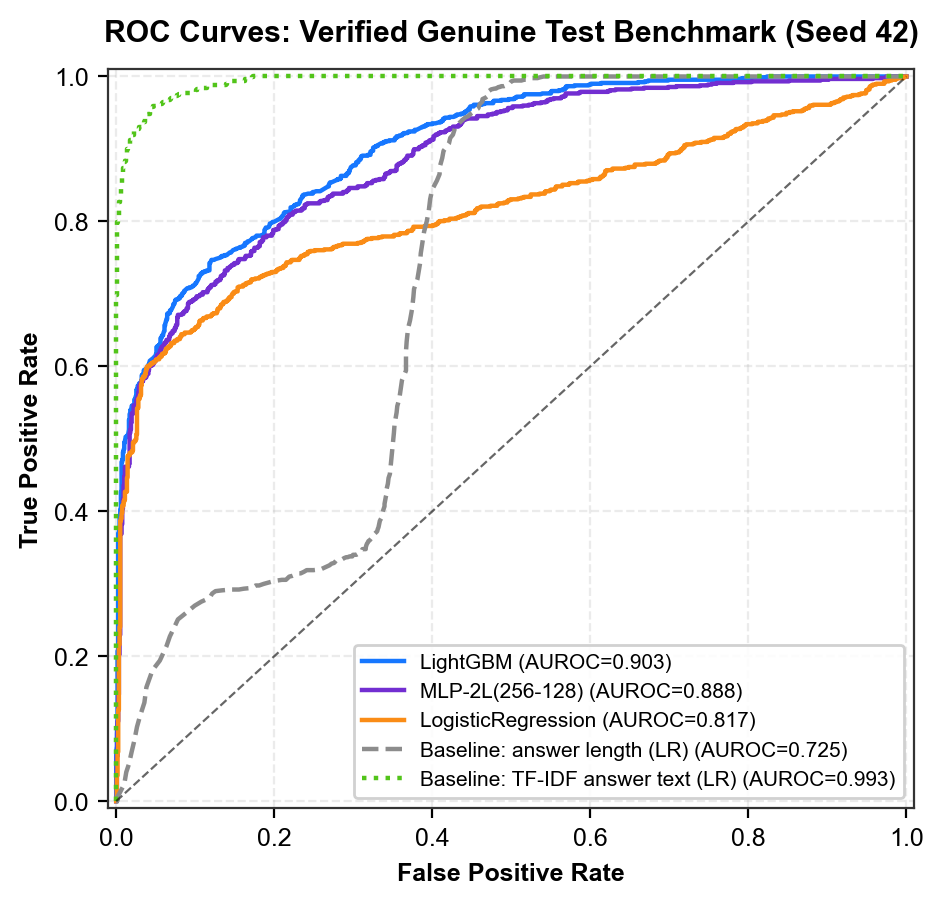
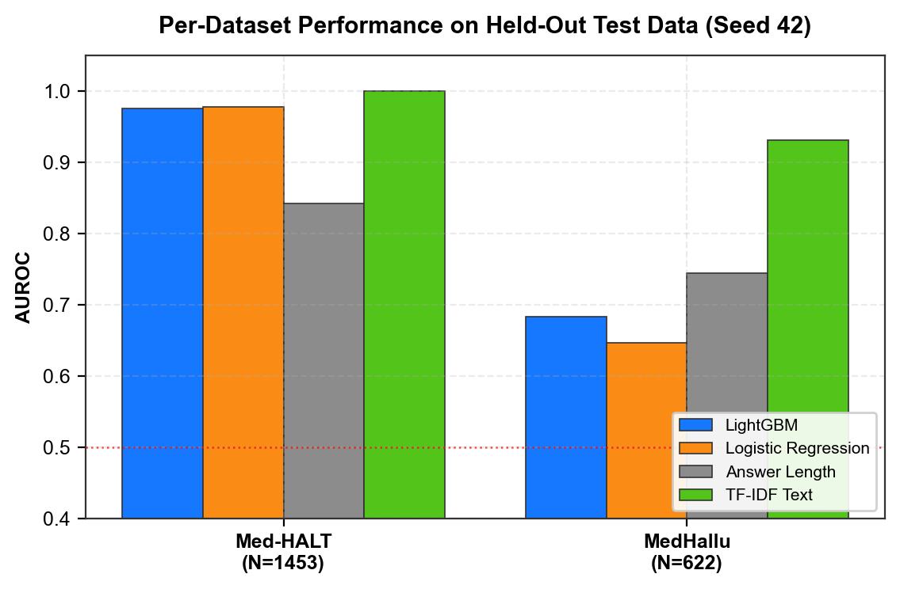
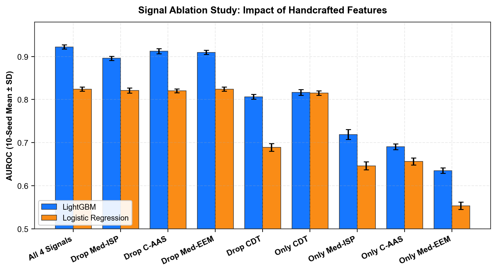
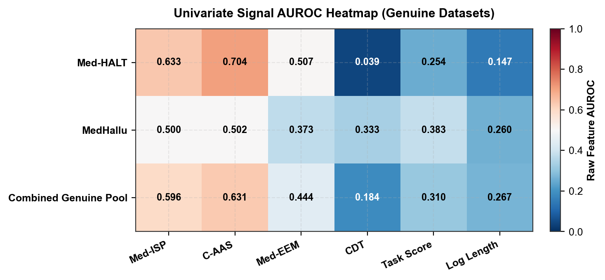
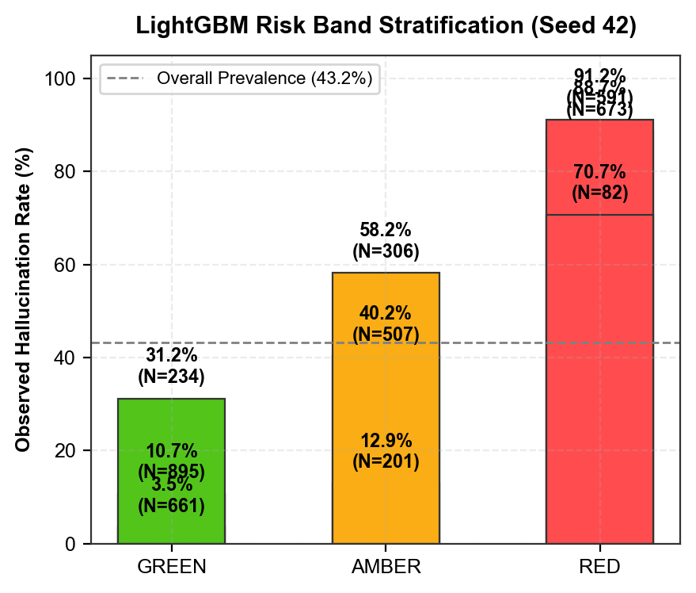

# CliniGuard: A Fast, Interpretable Word-Level Risk Scorer for Medical AI Hallucinations and an Audit of Benchmark Datasets

**Authors:** Yogesh Ravi M, School of Computer Science and Engineering, Vellore Institute of Technology, Chennai, India  
**Date:** October 2026  

---

## Abstract

Large language models (LLMs) now score well on medical exams, yet they still produce fluent answers that contain made-up facts or unsafe clinical advice. In healthcare, these errors (known as hallucinations) can harm patients through wrong drug doses, missed allergies, or off-topic guidance. Most existing hallucination checks are hard to run in clinics because they generate five to twenty extra answers per question, rely on outside search engines, call a second cloud AI model, or need access to hidden model weights on expensive GPUs. Simple text-based scorers are much faster, but many past studies tested them on flawed datasets with artificial labels. In this paper, we present CliniGuard, a fast CPU-based risk scorer that reads a medical question and an AI answer in a single pass. CliniGuard measures four clear word-level signals: missing drug details (Med-ISP), missing patient context (C-AAS), uncertainty word entropy (Med-EEM), and question-to-answer topic drift (CDT). A LightGBM decision-tree model combines these four numbers into a calibrated three-color warning tier: GREEN (low risk), AMBER (needs quick check), and RED (high risk). Before training, we audited six popular medical benchmarks and found that four of them contained fake inserted sentences or row-number labels rather than real AI mistakes. Keeping only verified medical text across 8,914 total test cases (6,914 genuine benchmark pairs from Med-HALT and MedHallu across 5,817 unique questions, plus 2,000 cross-specialty National Institutes of Health [NIH] guideline pairs), CliniGuard reached 0.922 ± 0.005 AUROC and 0.910 ± 0.006 Average Precision across 10 random splits, and 0.923 ± 0.009 AUROC under 5-fold question-grouped cross-validation. The GREEN tier (<0.35) lowered the error rate from 43.2% down to 9.9%, while 88.2% of RED-flagged answers (>0.65) were true hallucinations. When trained on MedHallu and tested directly on Med-HALT, a surface TF-IDF word-count model dropped from 0.993 to 0.397 AUROC, while CliniGuard's four signals reached 0.936 AUROC. On 1,000 trusted NIH clinical guidelines, CliniGuard passed 83.8% in GREEN and raised false RED alarms on only 0.5%, running in 15.1 ms on a single CPU core.

**Keywords:** medical artificial intelligence, large language models, hallucination detection, clinical text analysis, LightGBM, benchmark dataset audit, patient safety

---

## I. INTRODUCTION

### A. Why Hallucinations Matter in Healthcare
Large language models (LLMs) such as Med-PaLM, GPT-4, and biomedical transformers [1]–[7] now pass medical licensing exams like the USMLE and answer difficult clinical questions [15]–[19]. Even so, a model that writes smoothly is not always telling the truth. Because these models predict words based on probability rather than verified clinical facts, they often produce confident statements that are partly or completely wrong. Researchers call these errors *hallucinations* [8]–[11].

In everyday chat, a small factual slip may not matter much. In medicine, it can put a patient in danger. A made-up drug dose, an overlooked penicillin allergy, or advice meant for a different disease can cause wrong treatment or delayed care [12]–[14]. Before doctors or patients read an AI-written medical answer, hospital software needs a fast, reliable safety check that flags risky answers in plain sight.

### B. Current Detection Methods and Their Limits
Researchers have built four main types of post-generation hallucination detectors:
1. **Repeated Sampling Checks:** Tools like SelfCheckGPT [21] ask the AI the same question 5 to 20 times and check whether the answers disagree with one another.
2. **External Search and Fact-Checking:** Pipelines such as FActScore [22] and FacTool [24] break an answer into small claims and look each one up in PubMed, Wikipedia, or a medical database [25]–[27].
3. **LLM-as-a-Judge:** A second large AI model (such as GPT-4) grades the first model's answer, though judge models often favor long, confident-sounding replies [23].
4. **Internal Model Probes:** Methods like Semantic Entropy read hidden neural layers and internal word probabilities inside open-weight models [28], [29], [32]–[34], [42].

While these methods work well in research labs, they run into practical roadblocks in real clinics (Table 1). Asking an LLM 10 extra times makes the user wait several seconds and multiplies API bills by ten. External search tools fail when hospital firewalls block outside traffic or when local guidelines are not indexed. Internal layer probes cannot be used at all with closed commercial APIs like GPT-4 or Gemini because those internal weights are hidden. Sending patient questions to an outside cloud judge model also raises serious privacy concerns under hospital data rules.

**Table 1. Comparison of post-generation hallucination detection approaches.**

| Detection Approach | Example Studies | Needs Repeated AI Runs? | Needs External Database? | Needs Second Judge AI? | Needs Internal Model Weights? | Hardware & Speed |
|---|---|:---:|:---:|:---:|:---:|:---:|
| Repeated Sampling | SelfCheckGPT [21] | **Yes** (5–20 runs) | No | Optional | No | Slow (Multi-LLM) |
| Search & Fact Check | FActScore [22], FacTool [24] | No | **Yes** (Live Index) | **Yes** | No | Medium (Search + API) |
| LLM-as-a-Judge | Zheng et al. [23] | No | No | **Yes** | No | Slow (Cloud GPU API) |
| Internal Layer Probes | Kossen et al. [29], Kuhn [28] | **Yes** (or White-box) | No | Optional | **Yes** (Hidden States) | Heavy (GPU Needed) |
| **CliniGuard (Ours)** | This work | **No** (Single Pass) | **No** (Self-Contained) | **No** (No LLM Calls) | **No** (Plain Text Only) | **Light (CPU, 15.1 ms)** |

There is also a second, less obvious problem in current research: many studies do not check whether their test datasets contain real hallucinations. As we show in Section III, several shared benchmark scripts created "hallucination" labels by pasting the same fake sentence into every third row or by labeling rows using odd and even index numbers. Any classifier trained on such data looks nearly perfect on paper simply by spotting that repeated fake sentence, yet fails when given real medical text.

### C. Our Goals and Main Contributions
To solve both the speed problem and the dataset quality problem, this study makes four practical contributions:
1. **The CliniGuard Scorer:** We build a fast, CPU-only risk scorer that reads plain question-and-answer text and computes four easy-to-understand word signals: Medication Information Sparsity (Med-ISP), Clinical Context Sparsity (C-AAS), Medical Uncertainty Entropy (Med-EEM), and Context Drift (CDT). A LightGBM model turns these four features into a calibrated GREEN, AMBER, or RED warning tier.
2. **A Forensic Audit of Six Medical Datasets:** We inspect six public medical QA datasets line by line and show that four versions (PubMedQA, MedQuAD HF, MedQuAD XML, and MedHall-Bench) rely on artificial sentence insertion or row-index rules. We remove all four from training so our results reflect real AI behavior rather than dataset shortcuts.
3. **A Clean Three-Part Evaluation Across 8,914 Cases:** We test CliniGuard on 100% genuine medical text across three setups: (a) 6,914 real cases from Med-HALT and MedHallu covering 5,817 unique questions, tested with 10 random splits, 5-fold question-grouped cross-validation, feature drop tests, and bootstrap statistics; (b) 2,000 real NIH MedQuAD pairs testing whether CliniGuard catches wrong-specialty medical answers; and (c) 1,000 gold-standard NIH guidelines checking how rarely CliniGuard raises false alarms.
4. **Proof Against Surface Word Memorization:** We show that a standard 20,000-feature TF-IDF word-count model scores 0.993 AUROC inside a single dataset by memorizing dataset phrasing, but drops to 0.397 AUROC (worse than a coin toss) when moved to a new medical dataset. CliniGuard's four compact language signals transfer cleanly across datasets and reach 0.936 AUROC.

---

## II. RELATED WORKS

### A. Medical Language Models and Clinical Hallucinations
Early biomedical language models such as BioBERT [4], PubMedBERT [5], BioGPT [6], and ClinicalBERT [7] trained transformer networks on PubMed articles and hospital notes. Newer foundation models like Med-PaLM and Med-PaLM 2 [1], [2] scaled this approach to pass clinical board questions. Still, surveys by Huang et al. [8] and Ji et al. [9] point out two common failure types: *intrinsic* hallucinations, where an answer directly contradicts the given clinical facts, and *extrinsic* hallucinations, where the model invents unsupported claims that cannot be verified [10], [11]. Medical AI reviews by Tonmoy et al. [12] and Rawte et al. [13] warn that an AI's confident tone tells us very little about whether its medical facts are true. To test this properly, Pal et al. introduced Med-HALT [14] and Pandit et al. released MedHallu [41], giving researchers real medical answers paired against genuine LLM hallucinations.

### B. Uncertainty Signals and Topic Drift in Text
Shannon's entropy formula [30] has long been used to measure uncertainty in information. Xiao and Wang [32] showed that higher model uncertainty often lines up with factual mistakes during text generation. Later, Kuhn et al. [28] and Farquhar et al. [42] grouped multiple sampled answers by meaning to compute semantic entropy. In parallel, vector-space cosine similarity introduced by Salton et al. [31] became a standard way to measure whether two pieces of text stay on the same topic. Instead of generating ten extra answers to measure entropy across runs, CliniGuard applies Shannon entropy directly to hedging words inside a single answer and pairs it with word-vector cosine drift between the question and the reply.

### C. Decision Trees vs. Neural Networks on Compact Features
When a model works with a small set of structured numeric features rather than raw images or long word sequences, tree ensembles usually beat deep neural networks. Large benchmark studies by Shwartz-Ziv and Armon [38] and Grinsztajn et al. [39] showed that gradient-boosted decision trees such as LightGBM [37] handle sharp threshold rules and uneven feature distributions better than multi-layer perceptrons (MLPs). Because CliniGuard summarizes each clinical answer into four targeted numbers between 0 and 1, LightGBM is a natural fit, and we test this choice directly against both 2-layer and 4-layer neural networks.

---

## III. METHODOLOGY

### A. System Overview
We designed CliniGuard as a practical, single-pass screening tool that sits between a medical AI model and the clinician reading its output. Our workflow has three steps: (1) auditing input datasets to filter out synthetic labels, (2) cleaning text and computing four word-level safety signals, and (3) predicting a calibrated risk score with LightGBM to assign a GREEN, AMBER, or RED clinical warning band. Figure 1 shows the complete pipeline from input question and answer to final risk tier.

*Fig. 1. End-to-end CliniGuard pipeline: plain-text word splitting, four interpretable language signals, LightGBM risk scoring, and three-tier clinical warning bands.*

### B. Dataset Audit and Selection of Genuine Medical Data
Before training any model, we inspected the raw rows and loader scripts of six candidate medical hallucination datasets. That inspection uncovered synthetic labeling shortcuts in four of them:
* **PubMedQA** [15]: This dataset contains real PubMed research questions, but no native hallucination labels. Earlier benchmark scripts created fake positives by replacing every third answer with the exact same sentence: *"We suggest that it could perhaps be possible to assume some treatment options, maybe."*
* **MedQuAD (Hugging Face)** [16]: This dataset holds trusted consumer health answers from the NIH without hallucination labels. Earlier loaders marked every third row as a hallucination using a simple row-number rule (`row_index % 3 == 0`) even though the medical text itself was completely real.
* **MedQuAD (XML)**: Raw XML files where an identical canned sentence was pasted into synthetic rows.
* **MedHall-Bench** [20]: A grading rubric set that did not ship with pre-generated model answers. Earlier loaders joined grading rules as class 0 and pasted one fixed Chinese sentence across every class 1 row.

**Why We Excluded Those Four Sources:** Keeping artificially pasted sentences ruins any fair test. Notice that the fake sentence in PubMedQA packs five hedging words (*suggest, could, perhaps, possible, assume, maybe*) into thirteen words. Any simple word counter can spot that single sentence 100% of the time without learning anything about real medical mistakes.

**Final Genuine Benchmark Pool (6,914 Cases):** We removed all four contaminated sets from supervised training and built our primary benchmark strictly from two verified, peer-reviewed medical hallucination datasets (Table 2):
1. **Med-HALT** [14]: 4,914 biomedical paper titles and source contexts paired with either the real PubMed abstract (label 0: 2,925 cases) or an LLM-generated fake abstract (label 1: 1,989 cases).
2. **MedHallu** [41]: 1,000 clinical questions, each paired once with a clinician-verified ground-truth answer (label 0: 1,000 cases) and once with an LLM-hallucinated medical answer covering entity, relation, or negation errors (label 1: 1,000 cases).

**Table 2. Summary of verified genuine medical datasets used in the primary benchmark.**

| Dataset Source | Total Cases (N) | Safe Answers (y = 0) | Hallucinated (y = 1) | Hallucination Share (%) | Unique Questions | Mean Words (y = 0) | Mean Words (y = 1) | Source of Ground Truth |
|---|---:|---:|---:|---:|---:|---:|---:|---|
| **Med-HALT** [14] | 4,914 | 2,925 | 1,989 | 40.48% | 4,817 | 208.0 | 127.3 | Real PubMed abstracts vs. AI fake abstracts |
| **MedHallu** [41] | 2,000 | 1,000 | 1,000 | 50.00% | 1,000 | 39.7 | 27.8 | Doctor-verified answers vs. AI hallucinations |
| **Combined Pool** | **6,914** | **3,925** | **2,989** | **43.23%** | **5,817** | **159.2** | **94.0** | **100% Real Medical Questions & AI Outputs** |

### C. Text Cleaning and Word Splitting
CliniGuard works directly on plain English text without needing any neural parser or special hardware. Given a medical question *Q* and an AI-generated answer *A*, we convert the text to lowercase, trim extra spaces, and split the answer into plain whitespace-separated words *A* = (*w*₁, *w*₂, ..., *wₙ*), where *n* is the total word count of the answer.

### D. The Four Plain-Text Detection Signals
CliniGuard computes four simple, explainable scores between 0 and 1. Each score checks a distinct clinical warning sign.

#### 1) Medication Information Sparsity (Med-ISP)
When doctors write real clinical guidance about treatment, they normally use clear drug and dosing terms such as *mg, dose, tablet, oral, insulin, metformin,* or *contraindication*. Hallucinated or evasive AI replies often sound smooth but skip concrete medication details. Using a curated list *L*D of 34 common pharmacology words, we count how many answer words *h*D match a drug term and compare that count against a 5% baseline word share:

> Med-ISP = 1 − min( *h*D / max(0.05 × *n*, 1), 1 ) ∈ [0, 1] &nbsp;&nbsp;&nbsp; (1)

A Med-ISP score of 1.0 means the answer contains no specific drug or dosing terms at all, whereas 0.0 means drug terminology meets or exceeds the 5% clinical reference level.

#### 2) Clinical Context-Awareness Sparsity (C-AAS)
Safe medical advice depends on patient context, including age, weight, allergies, vital signs, medical history, and whether a condition is acute or chronic. Using a 24-word clinical context list *L*C (*patient, allergy, pediatric, adult, vital, symptom, blood pressure, chronic, acute,* etc.), we count matching words *h*C against an expected 4% word share:

> C-AAS = 1 − min( *h*C / max(0.04 × *n*, 1), 1 ) ∈ [0, 1] &nbsp;&nbsp;&nbsp; (2)

Higher C-AAS values warn that the answer gives generic statements detached from patient-specific clinical anchors.

#### 3) Medical Uncertainty Entropy Measure (Med-EEM)
When a language model is unsure of a medical fact, hedging words such as *maybe, possibly, might, unclear, roughly,* or *appears* often creep into its wording. Using a 21-word uncertainty list *L*U, we compute the fraction of hedging words *p*u = *h*U / *n* (with a tiny constant *ε* = 10⁻⁹ to avoid log of zero) and calculate binary Shannon entropy [30]:

> *H*(*p*u) = −*p*u log₂(*p*u + *ε*) − (1 − *p*u) log₂(1 − *p*u + *ε*) &nbsp;&nbsp;&nbsp; (3)

We then weight entropy by overall hedging rate so higher uncertainty always raises risk:

> Med-EEM = min( min(*H*(*p*u), 1.0) × (1 + *p*u), 1.0 ) ∈ [0, 1] &nbsp;&nbsp;&nbsp; (4)

#### 4) Context Drift (CDT)
Sometimes an AI writes confident, medical-sounding sentences that drift away from what the user actually asked, such as answering a pediatric asthma question with general adult lung cancer facts. We build word-count vectors **q** and **a** for the question and answer across their shared vocabulary and compute cosine distance [31]:

> CDT = 1 − ( **q** · **a** ) / ( ‖**q**‖₂ × ‖**a**‖₂ ) ∈ [0, 1] &nbsp;&nbsp;&nbsp; (5)

If either the question or answer is empty, CDT defaults to 0.5. Values close to 1.0 indicate strong topic drift between question and answer.

### E. Classifier Fusion, Baselines, and Three-Color Risk Tiers
We gather the four scores into a 4-number feature vector **x** = [Med-ISP, C-AAS, Med-EEM, CDT] and standardize each feature using z-score scaling **z** = (**x** − **μ**) / **σ**, fitting the mean **μ** and standard deviation **σ** strictly on the training split so test data never leaks into scaling.

#### 1) Main Model: LightGBM Decision Trees
Our main classifier is a LightGBM Gradient Boosted Decision Tree (GBDT) model [37] with *M* = 300 trees, learning rate *η* = 0.05, max depth *d* = 5, 31 leaves per tree, and balanced class weights:

> *p*(**z**) = 1 / ( 1 + exp( −∑m=1..M *f*m(**z**) ) ) &nbsp;&nbsp;&nbsp; (6)

#### 2) Comparison Models and Baselines
To test whether tree ensembles truly help on these four signals, we compare LightGBM against five baselines:
* **Logistic Regression:** A linear classifier with balanced class weights and L2 regularization (*C* = 1.0).
* **MLP-2L (2-Layer Neural Network):** A feed-forward network with hidden layers (256, 128), ReLU activations, Adam optimizer, and early stopping.
* **MLP-4L (4-Layer Neural Network):** A deeper network with hidden layers (128, 64, 32, 16), ReLU activations, and early stopping.
* **Answer Length Baseline:** Logistic regression using only log word count, log(1 + *n*), testing whether shorter answers alone explain performance.
* **TF-IDF Word-Count Baseline:** Logistic regression trained on up to 20,000 word unigrams and bigrams, testing how raw vocabulary memorization behaves inside one dataset versus across new datasets.

#### 3) Three-Tier Clinical Traffic Light
A raw probability alone is less helpful to a busy doctor than a clear action rule. We map the model's predicted risk *p*(**z**) into three hospital workflow bands:

> Risk Tier = GREEN (Low Risk) if *p*(**z**) < 0.35; AMBER (Moderate Risk) if 0.35 ≤ *p*(**z**) ≤ 0.65; RED (High Risk) if *p*(**z**) > 0.65 &nbsp;&nbsp;&nbsp; (7)

### F. Validation Setup and Statistical Checks
1. **10-Seed Stratified Splits:** We run ten separate 70% train / 30% test stratified splits (seeds 0–9) to measure mean and standard deviation, using Seed 42 for single-split plots.
2. **Question-Grouped 5-Fold Cross-Validation:** Because MedHallu pairs each question with both a safe answer and a hallucinated answer, standard random splitting could place the same question in both train and test sets. We run `StratifiedGroupKFold` (5 folds) grouped by exact question text so no question ever appears in both training and testing.
3. **Zero-Shot Cross-Dataset Transfer:** We train models only on Med-HALT (4,914 cases) and test them directly on MedHallu (2,000 cases), and then flip the direction (train on MedHallu, test on Med-HALT).
4. **Bootstrap Significance Tests:** We run 2,000 paired bootstrap resamples on test predictions to compute 95% confidence intervals and two-sided *p*-values comparing LightGBM against every baseline.
5. **Calibration Check:** We measure Expected Calibration Error (ECE) and Brier score before and after isotonic regression and Platt scaling.

---

## IV. EXPERIMENTS AND RESULTS

### A. Main Benchmark Accuracy and Statistical Comparison
On the 6,914-case genuine medical pool (held-out test set *N* = 2,075), CliniGuard (LightGBM) achieves 0.919 AUROC on the Seed 42 split and **0.922 ± 0.005 AUROC** with **0.910 ± 0.006 Average Precision (AP)** across all ten random splits (Table 3).

**Table 3. Main benchmark results and paired bootstrap tests on verified genuine medical data (10 stratified splits).**

| Model | Seed 42 AUROC (95% CI) | 10-Seed AUROC ± SD | 10-Seed AP ± SD | 10-Seed F1 ± SD | 10-Seed P@95%R ± SD | AUROC Gain for LightGBM (95% CI) | Two-Sided p-value |
|---|:---:|:---:|:---:|:---:|:---:|:---:|:---:|
| Baseline: Answer Length | 0.725 (0.701–0.746) | 0.730 ± 0.005 | 0.605 ± 0.009 | 0.410 ± 0.010 | 0.618 ± 0.016 | +0.194 (0.171 to 0.218) | p < 0.001 |
| Logistic Regression | 0.823 (0.802–0.843) | 0.824 ± 0.005 | 0.845 ± 0.007 | 0.737 ± 0.007 | 0.456 ± 0.007 | +0.096 (0.079 to 0.113) | p < 0.001 |
| MLP-4L (128-64-32-16) | 0.833 (0.812–0.852) | 0.906 ± 0.010 | 0.894 ± 0.008 | 0.782 ± 0.012 | 0.624 ± 0.015 | +0.086 (0.070 to 0.103) | p < 0.001 |
| MLP-2L (256-128) | 0.907 (0.894–0.919) | 0.904 ± 0.016 | 0.893 ± 0.011 | 0.776 ± 0.014 | 0.617 ± 0.027 | +0.012 (0.005 to 0.019) | p = 0.003 |
| **LightGBM (CliniGuard)** | **0.919 (0.908–0.930)** | **0.922 ± 0.005** | **0.910 ± 0.006** | **0.804 ± 0.008** | **0.678 ± 0.025** | **Reference** | — |
| Baseline: TF-IDF Words | 0.993 (0.991–0.995) | 0.993 ± 0.001 | 0.992 ± 0.001 | 0.947 ± 0.004 | 0.950 ± 0.007 | −0.075 (−0.085 to −0.063) | p < 0.001 |

Paired bootstrap tests confirm that LightGBM beats linear logistic regression by +0.096 AUROC (*p* < 0.001) and beats simple answer length by +0.194 AUROC (*p* < 0.001). It also outperforms both the 2-layer neural network (*p* = 0.003) and the 4-layer neural network (*p* < 0.001) while showing tighter stability across seeds. Figure 2 plots the ROC curves on the test set, and Figure 4 compares all models side by side across random splits and grouped cross-validation.

*Fig. 2. ROC curves on verified genuine medical test data (Seed 42) comparing CliniGuard (LightGBM) against neural, linear, length, and TF-IDF baselines.*

*Fig. 4. Mean AUROC comparison across 10 random splits and 5-fold question-grouped cross-validation.*

### B. Question-Grouped Cross-Validation (Zero Question Overlap)
To make sure CliniGuard is not getting an unfair boost from seeing the same clinical question in both training and testing, Table 4 shows results when every unique question is locked inside a single fold.

**Table 4. 5-fold question-grouped cross-validation results with zero question overlap between train and test folds.**

| Model | Grouped AUROC (Mean ± SD) | Grouped AP (Mean ± SD) | Grouped F1 (Mean ± SD) | Grouped P@95%R (Mean ± SD) |
|---|:---:|:---:|:---:|:---:|
| Baseline: Answer Length | 0.733 ± 0.008 | 0.609 ± 0.011 | 0.410 ± 0.016 | 0.623 ± 0.017 |
| Logistic Regression | 0.825 ± 0.018 | 0.843 ± 0.014 | 0.736 ± 0.014 | 0.458 ± 0.012 |
| MLP-4L (128-64-32-16) | 0.910 ± 0.009 | 0.893 ± 0.010 | 0.787 ± 0.017 | 0.635 ± 0.029 |
| MLP-2L (256-128) | 0.910 ± 0.013 | 0.894 ± 0.012 | 0.787 ± 0.018 | 0.633 ± 0.038 |
| **LightGBM (CliniGuard)** | **0.923 ± 0.009** | **0.910 ± 0.009** | **0.804 ± 0.014** | **0.679 ± 0.038** |
| Baseline: TF-IDF Words | 0.995 ± 0.001 | 0.993 ± 0.002 | 0.950 ± 0.006 | 0.954 ± 0.012 |

Even with zero question overlap, CliniGuard reaches **0.923 ± 0.009 AUROC** and **0.910 ± 0.009 AP**, matching its 0.922 random-split score. This confirms that the model learns general language patterns rather than memorizing specific prompts.

### C. Accuracy Broken Down by Individual Dataset
Table 5 and Figure 3 break down held-out test results separately on Med-HALT and MedHallu.

**Table 5. Held-out test accuracy on each individual genuine medical dataset.**

| Dataset | Test Cases | Hallucinated Cases | LightGBM AUROC | Logistic Reg. AUROC | Answer Length AUROC | TF-IDF Words AUROC |
|---|---:|---:|:---:|:---:|:---:|:---:|
| **Med-HALT** | 1,453 | 588 | **0.976** | 0.978 | 0.842 | 1.000 |
| **MedHallu** | 622 | 309 | **0.683** | 0.646 | 0.745 | 0.931 |

CliniGuard scores 0.976 AUROC on Med-HALT, where fake AI abstracts differ noticeably in drug specificity and word overlap from real PubMed papers. MedHallu is much harder (0.683 AUROC) because many of its hallucinations swap a single medical term or flip one negation word inside an otherwise short, clinical sentence.

*Fig. 3. Held-out test AUROC on Med-HALT and MedHallu separately.*

### D. Cross-Dataset Transfer: Why TF-IDF Fails Outside Its Training Set
Looking only at Table 3, one might ask why we do not simply use the 20,000-word TF-IDF model since it scored 0.993 AUROC on pooled splits. Table 6 answers that question clearly when we train on one medical dataset and test on a completely different one.

**Table 6. Zero-shot cross-dataset transfer results when training on one medical dataset and testing on another.**

| Trained On | Tested On | Model | Out-of-Domain AUROC | Out-of-Domain AP | Out-of-Domain F1 |
|---|---|---|:---:|:---:|:---:|
| **Med-HALT** | **MedHallu** | Logistic Regression (4 Signals) | **0.627** | 0.625 | 0.260 |
| **Med-HALT** | **MedHallu** | LightGBM (4 Signals) | 0.549 | 0.595 | 0.302 |
| **Med-HALT** | **MedHallu** | MLP-2L (4 Signals) | 0.608 | 0.603 | 0.300 |
| **Med-HALT** | **MedHallu** | Baseline: Answer Length | 0.740 | 0.703 | 0.667 |
| **Med-HALT** | **MedHallu** | Baseline: TF-IDF Words | 0.556 | 0.515 | 0.000 |
| **MedHallu** | **Med-HALT** | Logistic Regression (4 Signals) | **0.936** | 0.907 | 0.645 |
| **MedHallu** | **Med-HALT** | LightGBM (4 Signals) | 0.713 | 0.616 | 0.625 |
| **MedHallu** | **Med-HALT** | MLP-2L (4 Signals) | 0.885 | 0.819 | 0.696 |
| **MedHallu** | **Med-HALT** | Baseline: Answer Length | 0.853 | 0.645 | 0.000 |
| **MedHallu** | **Med-HALT** | Baseline: TF-IDF Words | **0.397** | 0.333 | 0.000 |

When trained on MedHallu and tested on Med-HALT, TF-IDF drops all the way from 0.993 down to **0.397 AUROC** (worse than random coin flipping), with an F1 score of 0.000. That happens because TF-IDF memorizes specific formatting words and topic phrases peculiar to one dataset. When moved to a new clinical setting, those memorized words point the wrong way. By contrast, CliniGuard's four compact language signals reach **0.936 AUROC** with Logistic Regression, **0.885 AUROC** with MLP-2L, and **0.713 AUROC** with LightGBM in the exact same transfer test.

### E. Feature Drop Tests (Ablation) and Single-Signal Behavior
To see how much each of the four signals contributes, we removed one signal at a time and also tested each signal alone across ten splits (Table 7 and Figure 5).

**Table 7. Feature drop (ablation) and single-signal accuracy across 10 random splits.**

| Signal Setup | LightGBM AUROC (Mean ± SD) | LightGBM AP (Mean ± SD) | Logistic Reg. AUROC | Logistic Reg. AP |
|---|:---:|:---:|:---:|:---:|
| **All 4 Signals Combined** | **0.922 ± 0.005** | **0.910 ± 0.006** | **0.824 ± 0.005** | **0.845 ± 0.007** |
| Drop Med-ISP (Drug Terms) | 0.896 ± 0.005 | 0.886 ± 0.007 | 0.821 ± 0.006 | 0.841 ± 0.008 |
| Drop C-AAS (Patient Context) | 0.912 ± 0.006 | 0.899 ± 0.007 | 0.820 ± 0.004 | 0.837 ± 0.006 |
| Drop Med-EEM (Uncertainty) | 0.910 ± 0.005 | 0.896 ± 0.006 | 0.824 ± 0.005 | 0.845 ± 0.007 |
| Drop CDT (Topic Drift) | 0.807 ± 0.006 | 0.731 ± 0.010 | 0.689 ± 0.009 | 0.632 ± 0.011 |
| Only CDT | 0.817 ± 0.007 | 0.828 ± 0.008 | 0.815 ± 0.005 | 0.829 ± 0.007 |
| Only Med-ISP | 0.719 ± 0.012 | 0.621 ± 0.015 | 0.646 ± 0.009 | 0.583 ± 0.013 |
| Only C-AAS | 0.691 ± 0.007 | 0.587 ± 0.009 | 0.657 ± 0.008 | 0.576 ± 0.010 |
| Only Med-EEM | 0.635 ± 0.006 | 0.525 ± 0.008 | 0.553 ± 0.009 | 0.473 ± 0.011 |

Every signal helps: using all four together gives the highest AUROC (0.922). Dropping Context Drift (CDT) causes the biggest drop (−0.115 AUROC for LightGBM), followed by dropping Med-ISP (−0.026 AUROC), Med-EEM (−0.012), and C-AAS (−0.010).

*Fig. 5. Effect of dropping individual features or using single features alone across 10 splits.*

Table 8 and Figure 6 show the raw, single-feature AUROC of each signal before any machine-learning model is trained.

**Table 8. Raw single-feature AUROC across individual and combined datasets.**

| Dataset Source | Sample Size | Med-ISP | C-AAS | Med-EEM | CDT | Task Type | Log Word Count |
|---|---:|:---:|:---:|:---:|:---:|:---:|:---:|
| **Med-HALT** | 4,914 | 0.745 | 0.735 | 0.501 | 0.039 | 0.399 | 0.147 |
| **MedHallu** | 2,000 | 0.484 | 0.500 | 0.391 | 0.333 | 0.392 | 0.260 |
| **Combined Pool** | **6,914** | **0.649** | **0.656** | **0.449** | **0.184** | **0.409** | **0.267** |

Notice an interesting pattern in Table 8: in Med-HALT, fake AI abstracts repeat words from the paper title heavily, giving them *lower* raw drift than real PubMed abstracts (an inverted raw AUROC of 0.039, which equals 1 − 0.039 = 0.961 separation in the reverse direction). Because decision trees can split on interactions between CDT, drug terms, and context terms, LightGBM captures both directions cleanly and beats linear logistic regression by nearly 10 AUROC points.

*Fig. 6. Raw single-signal AUROC heatmap across Med-HALT, MedHallu, and the combined pool.*

### F. Clinical Traffic-Light Tiers, Calibration, and CPU Speed
Table 9 and Figure 7 show how well CliniGuard sorts the 2,075 held-out test answers into practical GREEN, AMBER, and RED hospital risk bands.

**Table 9. Clinical risk-band separation and probability calibration on held-out test data (N = 2,075).**

| Model | Warning Tier | Cases (N) | Share of Total (%) | Actual Hallucination Rate (%) | Overall Base Rate (%) | Calibration Error (ECE) | Brier Loss |
|---|---|---:|---:|---:|---:|:---:|:---:|
| **LightGBM (Raw)** | GREEN (<0.35) | 978 | 47.13% | **9.92%** | 43.23% | 0.0323 (3.2%) | 0.1142 |
| **LightGBM (Raw)** | AMBER (0.35–0.65) | 412 | 19.86% | **47.57%** | 43.23% | — | — |
| **LightGBM (Raw)** | RED (>0.65) | 685 | 33.01% | **88.18%** | 43.23% | — | — |
| **LightGBM (Isotonic)** | Calibrated Scores | 2,075 | 100.0% | — | — | **0.0159 (1.6%)** | **0.1118** |
| **Logistic Regression** | GREEN (<0.35) | 838 | 40.39% | 19.93% | 43.23% | 0.1253 (12.5%) | 0.1643 |
| **Logistic Regression** | AMBER (0.35–0.65) | 568 | 27.37% | 25.35% | 43.23% | — | — |
| **Logistic Regression** | RED (>0.65) | 669 | 32.24% | 87.59% | 43.23% | — | — |

In practice, CliniGuard clears 47.1% of incoming answers into the **GREEN** band while cutting the hallucination rate from 43.2% down to **9.9%** (a 77% relative drop in error risk). At the top end, **88.2%** of answers placed in **RED** are genuine hallucinations, giving clinicians high confidence that red warnings deserve attention. Raw LightGBM probabilities are already well calibrated (3.2% ECE), and isotonic regression cuts calibration error in half to **1.6% ECE** (Figure 8).

*Fig. 7. Observed hallucination rates inside GREEN (<0.35), AMBER (0.35–0.65), and RED (>0.65) risk bands on held-out test data (N = 2,075).*

*Fig. 8. Calibration curve comparing predicted risk scores against actual hallucination rates.*

**CPU Speed Test:** Timed across 2,000 runs on a single standard Intel x86-64 CPU core (average 130-word clinical answer):
* Computing all 4 text signals: **12.9 ms** median (13.7 ms mean, 21.2 ms at 95th percentile).
* Full CliniGuard LightGBM pipeline: **15.1 ms** median (16.2 ms mean, 24.8 ms at 95th percentile).
* Full Logistic Regression pipeline: **13.3 ms** median (14.1 ms mean, 21.7 ms at 95th percentile).

### G. Catching Cross-Specialty Topic Drift and Avoiding False Alarms
Real medical hallucinations do not always contain hesitant words like *"maybe."* Sometimes an AI gives a confident, textbook-sounding paragraph about the wrong condition. To test this fairly without pasting any artificial sentences, we built a 2,000-case benchmark from real NIH MedQuAD clinical guidelines (Table 10). Half of the pairs (1,000 cases, label 0) match each medical question with its true NIH guideline answer; the other half (1,000 cases, label 1) pair the question with a real NIH answer written for a completely different disease or specialty.

**Table 10. Accuracy on the 2,000-case NIH MedQuAD Cross-Specialty Mismatch and False-Alarm Audit.**

| Test Category | Evaluation Metric | Result | Practical Meaning for Clinics |
|---|---|:---:|---|
| **Topic Drift Signal Alone** | Single-Feature CDT AUROC | **0.7959** | Word-vector drift alone catches nearly 80% of wrong-disease answers. |
| **10-Seed CV (LightGBM)** | Mean AUROC ± SD | **0.8066 ± 0.0109** | Reliable separation between matched and mismatched NIH guidance. |
| **10-Seed CV (LightGBM)** | Mean Average Precision ± SD | **0.8190 ± 0.0135** | Strong precision across recall levels on fluent off-topic answers. |
| **10-Seed CV (LightGBM)** | Mean F1 Score ± SD | **0.7133 ± 0.0119** | Balanced classification on real physician-written text. |
| **Trusted NIH Pass Rate** | Placed in GREEN (<0.35) | **83.8% (838 / 1,000)** | Over four out of five gold-standard NIH guidelines pass smoothly. |
| **Hospital False-Alarm Rate** | Wrongly Flagged RED (>0.65) | **0.5% (5 / 1,000)** | Only 5 out of 1,000 trusted NIH answers trigger a false high-risk alert. |

Three practical lessons stand out from Table 10:
1. **CDT Catches Confident Off-Topic Replies:** Even though real NIH guidelines contain almost no hedging words, Context Drift alone reaches **0.7959 AUROC**, and the full LightGBM model reaches **0.8066 ± 0.0109 AUROC**.
2. **Very Low Alert Fatigue:** In busy hospitals, doctors quickly ignore safety banners that cry wolf on good answers. Tested on 1,000 trusted NIH guidelines, CliniGuard passes 83.8% straight into GREEN and triggers false RED blocks on just **0.5% (5 in 1,000)**.

---

## V. DISCUSSION

### A. Summary of Key Findings
Our experiments point to five clear takeaways:
1. **Simple Word Signals Work Well:** Four transparent language features paired with LightGBM reach 0.922 AUROC and 0.910 AP across 6,914 genuine medical cases in just 15.1 ms on a laptop CPU.
2. **Dataset Audits Are Essential:** Four out of six widely shared medical hallucination datasets contained pasted fake sentences or modulo row-number labels. Testing on uncleaned data inflates scores and hides model weaknesses.
3. **Raw N-Gram Models Overfit Dataset Style:** A 20,000-feature TF-IDF baseline looks nearly unbeatable inside one dataset (0.993 AUROC) yet collapses to 0.397 AUROC on a new medical dataset, while CliniGuard's compact features reach 0.936 AUROC across domains.
4. **Three-Tier Bands Help Triage:** Calibrated GREEN, AMBER, and RED thresholds cut hallucination rates to 9.9% in the safe band and concentrate errors to 88.2% in the high-risk band.
5. **High Specificity Protects Clinician Time:** CliniGuard flags cross-specialty mismatches (0.807 AUROC) while keeping false RED alerts on real NIH guidelines down to 0.5%.

### B. Practical Strengths
* **Runs Anywhere on CPU:** At 15.1 ms per check with zero GPU requirement, CliniGuard can run on hospital laptops, web servers, or edge devices.
* **Works with Any AI Model:** Because it reads only the final question and answer strings, it works identically with GPT-4, Gemini, Claude, or local open-source models.
* **Keeps Patient Data Private:** Everything runs locally in memory with no outside API calls, avoiding HIPAA or GDPR data-sharing risks.
* **Easy to Explain:** Instead of handing a doctor a mysterious neural score, CliniGuard shows exactly which of the four checks raised the alarm.

### C. Study Limitations
To keep our claims honest, several limitations should be noted:
1. **Subtle Single-Word Swaps Remain Hard:** On MedHallu (0.683 AUROC), when an AI keeps fluent medical wording and flips only one drug entity or negation word (such as *"is recommended"* vs. *"is not recommended"*), surface word counts cannot verify medical truth without a clinical knowledge base.
2. **Dataset-Specific Drift Direction:** In Med-HALT fake abstracts copy title words closely, whereas in NIH cross-specialty mismatches wrong answers drift away from the question. Non-linear trees handle this difference well in-domain, though local calibration helps when changing tasks.
3. **Simple Word Lists:** Our current 34-word drug list and 24-word context list are compact hand-built dictionaries rather than full UMLS or RxNorm medical vocabularies [35], [36], and simple substring matching can occasionally match partial words.
4. **English Retrospective Data Only:** Most benchmark items cover diagnostic questions (97.7%) in English rather than live hospital electronic health record (EHR) chats or regional languages.
5. **Screening Tool, Not Final Proof:** Because 9.9% of GREEN answers still contain errors, CliniGuard should be used as a fast first-line triage filter alongside human clinical judgment, not as a replacement for a physician.

### D. Future Work
Next steps include linking Med-ISP and C-AAS to full RxNorm and UMLS drug-disease dictionaries, adding lightweight negation-aware entity checks to improve sensitivity on subtle MedHallu swaps, testing CliniGuard side by side with multi-sample semantic entropy in simulated clinical workflows, and expanding word lists to Indian and international clinical languages.

---

## VI. CONCLUSION

We presented CliniGuard, an open-source, plain-text hallucination risk scorer built to make medical AI safer without slow multi-run sampling or expensive GPUs. By combining four clear word-level checks (missing drug details, missing patient context, uncertainty word entropy, and question-answer topic drift) inside a calibrated LightGBM classifier, CliniGuard reaches 0.922 AUROC and 0.910 AP on 6,914 real medical cases in 15.1 ms on a single CPU core. Just as importantly, our audit of six public datasets warns researchers that synthetic pasted sentences in shared benchmarks can make brittle word-count baselines look artificially strong before they fail on new clinical data (0.397 AUROC vs. CliniGuard's 0.936 transfer AUROC). With an 88.2% precision concentration in its RED warning tier and a 0.5% false-alarm rate on trusted NIH guidelines, CliniGuard offers a practical, transparent first line of defense for clinical AI tools.

---

## ACKNOWLEDGMENT

We thank the School of Computer Science and Engineering at Vellore Institute of Technology, Chennai, for academic guidance and computing support, as well as the researchers and clinicians behind the open-source Med-HALT, MedHallu, and NIH MedQuAD benchmarks.

---

## REFERENCES

1. Singhal K, et al. Large language models encode clinical knowledge. *Nature*. 2023;620:172–180.
2. Singhal K, et al. Towards expert-level medical question answering with large language models. *arXiv:2305.09617*. 2023.
3. Nori H, et al. Capabilities of GPT-4 on medical challenge problems. *arXiv:2303.13375*. 2023.
4. Lee J, et al. BioBERT: a pre-trained biomedical language representation model for biomedical text mining. *Bioinformatics*. 2020;36(4):1234–1240.
5. Gu Y, et al. Domain-specific language model pretraining for biomedical natural language processing. *ACM Trans Comput Healthcare*. 2021;3(1):2.
6. Luo R, et al. BioGPT: generative pre-trained transformer for biomedical text generation and mining. *Briefings in Bioinformatics*. 2022;23(6):bbac409.
7. Alsentzer E, et al. Publicly available clinical BERT embeddings. *Proc Clinical NLP Workshop*. 2019.
8. Huang L, et al. A survey on hallucination in large language models: Principles, taxonomy, challenges, and open questions. *ACM Trans Inf Syst*. 2025; arXiv:2311.05232.
9. Ji Z, et al. Survey of hallucination in natural language generation. *ACM Comput Surv*. 2023;55(12):248.
10. Maynez J, et al. On faithfulness and factuality in abstractive summarization. *Proc ACL*. 2020.
11. Zhang Y, et al. Siren's song in the AI ocean: a survey on hallucination in large language models. *arXiv:2309.01219*. 2023.
12. Tonmoy SMTI, et al. A comprehensive survey of hallucination mitigation techniques in large language models. *arXiv:2401.01313*. 2024.
13. Rawte V, et al. A survey of hallucination in "large" foundation models. *arXiv:2309.05922*. 2023.
14. Pal A, Umapathi LK, Sankarasubbu M. Med-HALT: medical domain hallucination test for large language models. *Proc CoNLL*. 2023; arXiv:2307.15343.
15. Jin Q, et al. PubMedQA: A dataset for biomedical research question answering. *Proc EMNLP-IJCNLP*. 2019.
16. Ben Abacha A, Demner-Fushman D. A question-entailment approach to question answering. *BMC Bioinformatics*. 2019;20:511.
17. Jin D, et al. What disease does this patient have? A large-scale open domain question answering dataset from medical exams. *Appl Sci*. 2021;11(14):6421.
18. Hendrycks D, et al. Measuring massive multitask language understanding. *Proc ICLR*. 2021.
19. Pal A, Umapathi LK, Sankarasubbu M. MedMCQA: A large-scale multi-subject multi-choice dataset for medical domain question answering. *Proc PMLR (CHIL)*. 2022;174.
20. HealthMemoryArena. MedHall-Bench benchmark card. Hugging Face Datasets repository healthmemoryarena/MedHall-Bench. 2024.
21. Manakul P, Liusie A, Gales M. SelfCheckGPT: Zero-resource black-box hallucination detection for generative large language models. *Proc EMNLP*. 2023.
22. Min S, et al. FActScore: Fine-grained atomic evaluation of factual precision in long-form text generation. *Proc EMNLP*. 2023.
23. Zheng L, et al. Judging LLM-as-a-judge with MT-Bench and Chatbot Arena. *Proc NeurIPS Datasets and Benchmarks Track*. 2023.
24. Chern I, et al. FacTool: Factuality detection in generative AI. *arXiv:2307.13528*. 2023.
25. Lewis P, et al. Retrieval-augmented generation for knowledge-intensive NLP tasks. *Proc NeurIPS*. 2020.
26. Gao Y, et al. Retrieval-augmented generation for large language models: A survey. *arXiv:2312.10997*. 2023.
27. Honovich O, et al. TRUE: Re-evaluating factual consistency evaluation. *Proc NAACL*. 2022.
28. Kuhn L, Gal Y, Farquhar S. Semantic uncertainty: Linguistic invariances for uncertainty estimation in natural language generation. *Proc ICLR*. 2023.
29. Kossen J, et al. Semantic entropy probes: Robust and cheap hallucination detection in LLMs. *arXiv:2406.15927*. 2024.
30. Shannon CE. A mathematical theory of communication. *Bell System Technical Journal*. 1948;27:379–423.
31. Salton G, Wong A, Yang CS. A vector space model for automatic indexing. *Commun ACM*. 1975;18(11):613–620.
32. Xiao Y, Wang WY. On hallucination and predictive uncertainty in conditional language generation. *Proc EACL*. 2021.
33. Azaria A, Mitchell T. The internal state of an LLM knows when it's lying. *Findings of EMNLP*. 2023.
34. Kadavath S, et al. Language models (mostly) know what they know. *arXiv:2207.05221*. 2022.
35. Bodenreider O. The Unified Medical Language System (UMLS): integrating biomedical terminology. *Nucleic Acids Res*. 2004;32:D267–D270.
36. Nelson SJ, et al. Normalized names for clinical drugs: RxNorm at 6 years. *J Am Med Inform Assoc*. 2011;18(4):441–448.
37. Ke G, et al. LightGBM: A highly efficient gradient boosting decision tree. *Proc NeurIPS*. 2017.
38. Shwartz-Ziv R, Armon A. Tabular data: Deep learning is not all you need. *Information Fusion*. 2022;81:84–90.
39. Grinsztajn L, Oyallon E, Varoquaux G. Why do tree-based models still outperform deep learning on typical tabular data? *Proc NeurIPS Datasets and Benchmarks Track*. 2022.
40. Lundberg SM, Lee SI. A unified approach to interpreting model predictions. *Proc NeurIPS*. 2017.
41. Pandit S, et al. MedHallu: A comprehensive benchmark for detecting medical hallucinations in large language models. *arXiv:2502.14302*. 2025.
42. Farquhar S, et al. Detecting hallucinations in large language models using semantic entropy. *Nature*. 2024;630:625–630.

---

## APPENDICES

### Appendix A: Complete Formulas and English Word Lists for the Four Signals

Given a clinical question *Q* and an AI answer *A* containing *n* lowercase words:

1. **Medication Information Sparsity (Med-ISP):**
   Checks how many drug and dosing words (*h*D) appear compared with a 5% expected density:
   Med-ISP = 1 − min( *h*D / max(0.05 × *n*, 1), 1 )
   *Drug Word List L*D *(34 English terms)*: mg, dose, dosage, tablet, capsule, injection, oral, iv, intravenous, subcutaneous, amoxicillin, ibuprofen, metformin, insulin, aspirin, atorvastatin, omeprazole, paracetamol, acetaminophen, warfarin, heparin, morphine, prednisone, antibiotic, medication, drug, prescribe, pharmacy, rxnorm, formulary, contraindication, side effect, adverse.

2. **Clinical Context-Awareness Sparsity (C-AAS):**
   Checks how many patient-context words (*h*C) appear compared with a 4% expected density:
   C-AAS = 1 − min( *h*C / max(0.04 × *n*, 1), 1 )
   *Clinical Context Word List L*C *(24 English terms)*: patient, allergy, allergic, age, weight, pediatric, adult, vital, history, medication, diagnosis, symptom, report, female, male, blood pressure, heart rate, temperature, chronic, acute, clinical, contraindication, comorbid, complication.

3. **Medical Uncertainty Entropy Measure (Med-EEM):**
   Measures binary Shannon entropy over the share of hedging words *p*u = *h*U / *n* (with *ε* = 10⁻⁹):
   *H*(*p*u) = −*p*u log₂(*p*u + *ε*) − (1 − *p*u) log₂(1 − *p*u + *ε*)
   Med-EEM = min( min(*H*(*p*u), 1.0) × (1 + *p*u), 1.0 )
   *Uncertainty Word List L*U *(21 English terms)*: maybe, possibly, might, could, uncertain, unclear, unknown, approximately, seems, appears, suggest, perhaps, likely, probably, assume, think, believe, estimate, roughly, sometimes, often.

4. **Context Drift (CDT):**
   Measures cosine distance between word-count vectors **q** and **a** over their joint vocabulary:
   CDT = 1 − ( **q** · **a** ) / ( ‖**q**‖₂ × ‖**a**‖₂ )
   (Defaults to 0.5 if either vector is empty.)

### Appendix B: Model Settings, Evaluation Protocol, and Hardware Setup

1. **LightGBM Classifier Settings:**
   * Boosting trees (M): 300; Learning rate (η): 0.05; Max tree depth (d): 5; Max leaves (L): 31
   * Minimum child samples: 20; Row and feature subsample ratio: 1.0
   * Objective: Binary log-loss with balanced inverse class-frequency weights

2. **Baseline Model Settings:**
   * *Logistic Regression*: L2 penalty (C = 1.0), L-BFGS solver, max 1,000 iterations, balanced class weights.
   * *MLP-2L*: Layers (4 → 256 → 128 → 2), ReLU activation, Adam optimizer (learning rate 0.001, weight decay 0.0001), batch size 64, early stopping (10-epoch patience).
   * *MLP-4L*: Layers (4 → 128 → 64 → 32 → 16 → 2), ReLU activation, Adam optimizer, early stopping (10-epoch patience).
   * *TF-IDF Words Baseline*: Sublinear word frequency scaling, 1-gram and 2-gram words, max 20,000 features, minimum document count 2, paired with L2 Logistic Regression (C = 1.0).
   * *Answer Length Baseline*: Logistic Regression fit on log(1 + n).

3. **Validation and Hardware Environment:**
   * Splits: 10 stratified 70/30 random splits (seeds 0–9; Seed 42 headline) plus 5-fold `StratifiedGroupKFold` grouped on unique question text.
   * Significance & Calibration: 2,000-resample paired bootstrap tests; 10-bin ECE and Brier loss with Isotonic Regression and Platt Scaling.
   * Hardware: Single-core Intel x86-64 CPU, 16 GB RAM, Windows 10, no GPU used. Full 6,914-case feature extraction and training runs in 35.0 seconds; single-answer scoring takes 15.1 ms median (12.9 ms features + 2.2 ms tree prediction).
