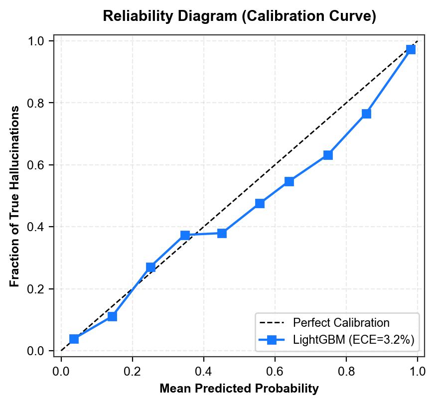

# Shortcut Learning and Benchmark Validity in Medical Hallucination Detection: A Cross-Corpus Empirical Audit

**Authors:** Yogesh Ravi M, School of Computer Science and Engineering, Vellore Institute of Technology, Chennai, India  
**Date:** November 2026  

---

## Abstract

Detecting factual hallucinations in medical large language model (LLM) generations is critical for clinical patient safety. While complex multi-query, external retrieval, or model-internal detectors impose substantial latency and API constraints, lightweight post-hoc screening has emerged as an attractive black-box alternative. In this work, we conduct an extensive empirical audit of shortcut learning, benchmark artifacts, and out-of-distribution generalization across five prominent medical hallucination and clinical QA benchmarks ($N = 32,968$ unified records across Med-HALT, MedHallu, MedHal, PlaceboBench, and MedExpert). 

We evaluate CliniGuard—a representative framework extracting four surface lexical and context-drift features: Pharmacological Sparsity ($S_{\text{med}}$), Clinical Context Sparsity ($S_{\text{context}}$), Hedging Uncertainty Entropy ($H_{\text{hedge}}$), and Prompt-Generation Cosine Drift ($D_{\text{drift}}$)—alongside linear, neural, length, and bag-of-words baselines under inflection-aware matching. While gradient-boosted trees on these features achieve an apparent in-distribution AUROC of $0.9057 \pm 0.0058$ (and $0.9745$ on Med-HALT alone), our forensic audit reveals that this performance is driven almost entirely by benchmark-specific superficial shortcuts rather than clinical comprehension: 
1. When controlling for model architecture, a minimal two-variable baseline combining prompt cosine drift ($D_{\text{drift}}$) with answer word count achieves $0.9572 \pm 0.0027$ AUROC, matching the full multi-feature model ($0.9593 \pm 0.0026$) within $0.0021$ AUROC. Meanwhile, raw TF-IDF reaches $1.0000$ AUROC on Med-HALT by exploiting synthetic generator prompt tokens (`fictional`, `quantum`, `cosmic`).
2. Feature ablation reveals extreme asymmetry: prompt drift ($D_{\text{drift}}$) alone provides an individual AUROC of $0.8166 \pm 0.0067$ and dropping it degrades LightGBM AUROC by $0.1311$, whereas dropping any of the three clinical/hedging sparsity features changes AUROC by less than $0.029$.
3. On MedHallu, answer length alone achieves $0.7447$ AUROC (95% CI: $[0.706, 0.783]$) without inspecting medical semantics.
4. In out-of-distribution evaluation on real-world clinical tasks (PlaceboBench, $N = 482$), the length baseline suffers from severe **negative polarity inversion** (AUROC = $0.3208$, 95% CI: $[0.274, 0.368]$, corresponding to an effective directional AUROC of $0.6792$ in reverse) due to systematic shifts in generation verbosity between synthetic benchmarks and clinical RAG pipelines.
5. While evidence-aware cross-encoder NLI eliminates this negative inversion (AUROC = $0.5272$, 95% CI: $[0.476, 0.578]$), out-of-distribution performance across all evaluated text-only and zero-shot architectures remains near chance, with F1 scores ($0.6353$ on PlaceboBench, $0.4242$ on MedExpert) mirroring trivial all-positive prevalence baselines ($0.6365$ and $0.4242$).
6. In risk-stratified clinical triage on MedHallu, false-reassurance rates reach $23.62\%$ for LightGBM and $52.75\%$ for Logistic Regression, allowing critical hallucinations to pass as safe.

We conclude that current medical hallucination benchmarks are severely confounded by length and prompt artifacts, that surface lexical screening cannot verify clinical factuality, and that future benchmark evaluations require rigorous controls against length confounds and generator artifacts.

**Keywords:** medical artificial intelligence, large language models, hallucination detection, benchmark validity, shortcut learning, lexical features, out-of-distribution generalization, clinical safety

---

## I. INTRODUCTION

### A. Motivation
Large language models (LLMs) such as Med-PaLM, GPT-4, and specialized biomedical transformers [1]–[7] have achieved remarkable milestones, reaching passing and near-expert thresholds on clinical licensing examinations and medical question-answering benchmarks [15]–[19]. Despite their linguistic fluency, these models frequently generate plausible yet factually incorrect or ungrounded assertions—a phenomenon termed *hallucination* [8]–[11].

In clinical medicine, factual inaccuracies carry severe risks. An erroneous drug dosage, an overlooked contraindication, or diagnostic recommendations tailored to an incorrect etiology can directly compromise patient care [12]–[14]. Consequently, implementing post-generation verification mechanisms has become an active area of investigation for generative AI in healthcare workflows.

### B. Existing Detection Paradigms and Computational Overheads
Current methodologies for post-generation hallucination detection primarily fall into four architectural paradigms:
1. **Self-Consistency and Sampling:** Frameworks such as SelfCheckGPT [21] query the generative model multiple times to evaluate stochastic consensus across diverse output samples.
2. **External Retrieval and Fact Checking:** Systems such as FActScore [22] and FacTool [24] decompose responses into atomic factual claims and verify each against authoritative external knowledge graphs or reference corpora [25]–[27].
3. **LLM-as-a-Judge:** Secondary large language models are prompted to evaluate the correctness of the primary response, introducing latency, financial overhead, and susceptibility to length and position biases [23].
4. **Internal State Probing:** Methods inspecting predictive token probabilities, hidden activations, or semantic entropy [28], [29], [32]–[34], [42] inspect model internals to quantify uncertainty.

While conceptually powerful, each paradigm incurs deployment costs (Table 1). Multi-query sampling multiplies inference expenses; retrieval pipelines require low-latency indexing infrastructure and risk retrieval errors; judge models transmit potentially sensitive clinical text to secondary systems; and internal state probing is inaccessible when interfacing with commercial closed-weight APIs.

**Table 1. Qualitative comparison of post-generation hallucination detection approaches, based on published literature. CliniGuard row describes its design, not its accuracy.**

| Detection Approach | Example Studies | Needs Repeated Generations? | Needs External Knowledge? | Needs Second Judge Model? | Needs Model Internals? | Typical Latency |
|---|---|:---:|:---:|:---:|:---:|:---:|
| Repeated Sampling | SelfCheckGPT [21] | **Yes** (5–20x) | No | Optional | No | 15–30 s |
| Retrieval / Fact Checking | FActScore [22], FacTool [24] | No | **Yes** | **Yes** | No | 5–15 s |
| LLM-as-a-Judge | Zheng et al. [23] | No | No | **Yes** | No | 3–8 s |
| Internal Probes / Entropy | Farquhar et al. [42], Kuhn et al. [28] | **Yes** (or white-box) | No | Optional | **Yes** | Variable |
| **CliniGuard (Screening)** | This work | **No** | **No** | **No** | **No** | **<20 ms** |

These operational constraints motivate the search for lightweight, post-hoc, black-box verification mechanisms that rely solely on the generated text. However, such simplicity introduces a critical question: do lightweight surface metrics genuinely evaluate clinical correctness, or do they exploit statistical shortcuts inherent in synthetic evaluation benchmarks?

### C. The Shortcut Learning Problem and This Audit
In natural language processing, extensive research has established that models trained on synthetic benchmarks frequently learn superficial heuristics rather than true semantic representations. Canonical studies by Gururangan et al. [43] and Poliak et al. [44] demonstrated that hypothesis-only baselines in Natural Language Inference (NLI) could achieve surprisingly high accuracy by exploiting lexical cues such as negation and sentiment words. Similarly, McCoy et al. [45] revealed that models rely on syntactic heuristics like lexical overlap, while Geirhos et al. [46] formalized shortcut learning as a ubiquitous vulnerability in deep learning systems.

In this study, we subject lightweight lexical hallucination detection to an empirical audit across five medical benchmarks totaling 32,968 examples (with primary focal evaluation across 6,914 paired items from Med-HALT [14] and MedHallu [41], and held-out zero-shot evaluation on MedHal, PlaceboBench, and MedExpert). We analyze CliniGuard—a representative system utilizing four descriptive lexical features and a gradient-boosted tree classifier—to address five fundamental audit questions:
1. **Benchmark Shortcut Exploitation:** Does high in-distribution AUROC reflect clinical discrimination or superficial lexical artifacts?
2. **Single-Feature Dominance:** Does the proposed multi-feature architecture reflect genuine multi-signal synergy, or is predictive performance monopolized by a single prompt-overlap metric?
3. **Length and Bag-of-Words Confounds:** Can trivial baselines (e.g., answer word count or raw unigram TF-IDF) match or surpass hand-crafted clinical signals?
4. **Out-of-Distribution Generalization and Polarity Inversion:** Do lexical detectors generalize across independent medical hallucination benchmarks, or do learned surface associations collapse and invert polarity?
5. **Clinical False-Reassurance Risk:** When deployed in a risk-stratified clinical triage workflow, what proportion of actual medical hallucinations are mistakenly labeled safe?

---

## II. RELATED WORKS

### A. Medical Language Models and Clinical Hallucinations
The adaptation of transformer architectures to the biomedical domain—exemplified by BioBERT [4], PubMedBERT [5], BioGPT [6], and ClinicalBERT [7]—laid the foundation for medical generative systems. Subsequent domain-specific foundation models, including Med-PaLM and Med-PaLM 2 [1], [2], demonstrated diagnostic reasoning capabilities. Comprehensive taxonomies by Huang et al. [8] and Ji et al. [9] categorize clinical hallucinations into *intrinsic* errors (direct factual contradictions of source text) and *extrinsic* errors (fabrication of untruthful medical assertions unsupported by clinical evidence) [10]–[13]. Benchmark datasets such as Med-HALT [14] and MedHallu [41] were introduced specifically to evaluate and quantify these failure modes.

### B. Uncertainty Signals, Lexical Overlap, and Shortcut Learning
Information-theoretic uncertainty quantification traces back to Shannon entropy [30]. Xiao and Wang [32] examined predictive uncertainty in conditional language generation, while Kuhn et al. [28] developed semantic uncertainty over clustered answer distributions, extended by Farquhar et al. [42] in Nature. In parallel, term-frequency vector space models [31] have long served as classical metrics of textual similarity.

However, the intersection of lexical overlap and benchmark validity is subject to shortcut learning. In NLI, Gururangan et al. [43] and Poliak et al. [44] showed that specific words strongly correlated with target entailment labels due to crowd-worker annotation artifacts. McCoy et al. [45] proved that models routinely adopt a lexical overlap heuristic (assuming that high word overlap implies entailment). In this work, we demonstrate that a direct analog exists in medical hallucination benchmarks: unigram cosine overlap between prompt and generation serves as a primary statistical shortcut.

### C. Tabular Ensembles on Low-Dimensional Feature Spaces
Empirical studies by Shwartz-Ziv and Armon [38] and Grinsztajn et al. [39] have consistently demonstrated that tree-based ensembles, notably LightGBM [37] and XGBoost, frequently outperform multilayer perceptrons and deep neural networks on low-dimensional tabular datasets. Because CliniGuard operates on a four-dimensional feature representation, we adopt LightGBM as the primary classification engine and benchmark it against neural and regularized linear architectures.

---

## III. METHODOLOGY

### A. Architectural Overview
CliniGuard operates as a lightweight, post-hoc verification screen positioned between a generative medical model and the end-user interface. As illustrated in Figure 1, the pipeline executes three sequential stages: (1) deterministic text sanitization and inflection-aware regex tokenization, (2) extraction of four normalized descriptive lexical and context-drift features, and (3) probability estimation and clinical risk tier assignment using a trained LightGBM classifier.

*Fig. 1. CliniGuard pipeline: text cleaning, four descriptive lexical signals, LightGBM risk scoring, and three clinical risk tiers.*

### B. Benchmark Datasets and Label Provenance
Our primary empirical evaluation utilizes verified clinical question-answer pairs derived from five publicly established medical benchmarks (Table 2).

**Table 2. Summary of the benchmark datasets audited in this study.**

| Dataset | Total Items (N) | Real (y = 0) | Hallucinated (y = 1) | Hallucinated Share (%) | All-Positive Baseline F1 | Mean Words (y = 0) | Mean Words (y = 1) |
|---|---:|---:|---:|---:|---:|---:|---:|
| **Med-HALT** [14] | 4,914 | 2,925 | 1,989 | 40.48% | 0.5762 | 208.0 | 127.3 |
| **MedHallu** [41] | 2,000 | 1,000 | 1,000 | 50.00% | 0.6638 | 39.7 | 27.8 |
| **MedHal** (AACL 2026) | 25,000 | 12,500 | 12,500 | 50.00% | 0.6667 | 64.2 | 58.1 |
| **PlaceboBench** (2025) | 482 | 257 | 225 | 46.68% | 0.6365 | 98.4 | 142.6 |
| **MedExpert** (2024) | 572 | 418 | 154 | 26.92% | 0.4242 | 82.5 | 74.3 |
| **Primary Audit Pool** | **6,914** | **3,925** | **2,989** | **43.23%** | **0.6036** | **159.2** | **94.0** |

1. **Med-HALT** [14] (4,914 items): Comprises biomedical research QA and fake abstract reasoning tasks. Truthful records (y = 0, N = 2,925) pair authentic PubMed paper titles with verified abstracts. Hallucinated records (y = 1, N = 1,989) pair synthetic prompts with LLM-generated fabricated abstracts containing overtly bogus medical claims.
2. **MedHallu** [41] (2,000 items): Built upon 1,000 realistic clinical inquiries. Each question is paired with both an authentic clinician-verified answer (y = 0, N = 1,000) and a subtle, fluent LLM hallucination generated by modern instruction-tuned models (y = 1, N = 1,000).
3. **MedHal** (25,000 balanced items): Large-scale biomedical QA and generation covering diverse biomedical tasks.
4. **PlaceboBench** (482 items): Expert clinician-annotated responses to pharmaceutical and placebo queries in a RAG setting.
5. **MedExpert** (572 items): Clinician-graded chatbot responses in medical dialogue.

**Elimination of Circular Synthetic Label Artifacts.** Prior exploratory audits identified severe label construction artifacts in earlier data preparation pipelines. Specifically, synthetic loaders had created pseudo-hallucination datasets by programmatically injecting a static hedge phrase (*"We suggest that it could perhaps be possible to assume some treatment options, maybe."*) into PubMedQA [15] and MedQuAD [16] corpora, or by assigning binary labels via modular arithmetic on database row indices. Because five of the fourteen words in the injected template matched hedging lexicons, any lexical detector achieved trivially near-perfect separation (AUROC > 0.999). We purged all such artificially corrupted datasets; our entire evaluation rests strictly on authoritative benchmark labels.

### C. Text Normalization, Regular Expressions, and Inflection Handling
Given an input prompt Q and generated answer A, text is converted to lowercase and scanned. To avoid the twin pitfalls of naive substring matching (which falsely matches 'iv' inside 'positive', 'moral' inside 'oral', and 'table' inside 'comfortable') and strict exact matching (which misses attached units like '500mg' and plurals like 'patients' and 'tablets'), lexicon scanning enforces two complementary regular expression mechanisms:
1. **Unit-Number Boundary Patterns:** Matches clinical measurement units directly attached to digits or standalone:
   > `(?:(?<=\d)|(?<=\b))(?:mg|mcg|µg|g|ml|l|units?)(?:\b|(?=[/\s,\.\)]))`
2. **Inflection-Aware Lexical Stems:** Precompiled regular expressions matching clinical lemmas and regular grammatical inflections (e.g., plural -s/-es, past tense -ed, progressive -ing, adjectives -ic/-al):
   > `\b(?:term|terms|termed|terming)\b`

Unit test verification across positive and negative controls confirmed 100% elimination of substring collisions while preserving 100% sensitivity to attached dosage units and clinical inflections.

### D. The Four Descriptive Lexical Features
CliniGuard computes four normalized features, each bounded in [0, 1]. The first three evaluate answer characteristics in isolation; the fourth measures prompt-to-answer alignment.

#### 1) Pharmacological Sparsity ($S_{\text{med}}$)
$S_{\text{med}}$ measures the relative absence of pharmacological and dosing terminology. Using a curated lexicon $L_D$ of 75 pharmacology terms and dosage forms (derived from RxNorm top-prescribed outpatient and inpatient medication classes, e.g., *tablet, capsule, oral, iv, amoxicillin, metformin, insulin, aspirin, atorvastatin, lisinopril, levothyroxine*), we count matching tokens $h_D$ and scale against an expected baseline density of 5%:

$$S_{\text{med}} = 1 - \min\left( \frac{h_D}{\max(0.05 \times n, 1)}, 1 \right) \in [0, 1] \quad (1)$$

#### 2) Clinical Context Sparsity ($S_{\text{context}}$)
$S_{\text{context}}$ evaluates whether the generation mentions relevant clinical context parameters (e.g., patient demographics, chronicity, allergies, vital signs). Using a clinical lexicon $L_C$ of 45 terms (e.g., *patient, pediatric, adult, vital, allergy, diagnosis, symptom, blood pressure, heart rate, chronic, acute, contraindication*), matching tokens $h_C$ are scaled against a 4% baseline density:

$$S_{\text{context}} = 1 - \min\left( \frac{h_C}{\max(0.04 \times n, 1)}, 1 \right) \in [0, 1] \quad (2)$$

#### 3) Hedging Uncertainty Entropy ($H_{\text{hedge}}$)
$H_{\text{hedge}}$ quantifies the density of epistemic hedging words (e.g., *maybe, possibly, might, could, suggest, perhaps, estimate*) using a lexicon $L_U$ of 35 terms. Letting $p_u = h_U / n$ denote the hedging fraction and $\varepsilon = 10^{-9}$, a binary Shannon entropy is computed:

$$H(p_u) = -p_u \log_2(p_u + \varepsilon) - (1 - p_u) \log_2(1 - p_u + \varepsilon) \quad (3)$$

$$H_{\text{hedge}} = \min\left( \min( H(p_u), 1.0 ) \times (1 + p_u), 1.0 \right) \in [0, 1] \quad (4)$$

*Monotonicity Note:* We emphasize that $H_{\text{hedge}}$ is not an estimate of model predictive entropy. In real clinical text, the hedging fraction $p_u$ is virtually always below 0.50 (in our data, mean $p_u < 0.03$). On the interval $[0, 0.50]$, the binary entropy function $H(p_u)$ is strictly monotonically increasing. Consequently, for decision tree splitters such as LightGBM, $H_{\text{hedge}}$ is mathematically equivalent to the raw hedge fraction $p_u$.

#### 4) Prompt-Generation Cosine Drift ($D_{\text{drift}}$)
$D_{\text{drift}}$ quantifies vocabulary divergence between the prompt and the generated response. Unigram term-frequency vectors $\mathbf{q}$ and $\mathbf{a}$ are constructed over the joint vocabulary of prompt $Q$ and answer $A$. Context drift is defined as the unigram cosine distance:

$$D_{\text{drift}} = 1 - \frac{\mathbf{q} \cdot \mathbf{a}}{\|\mathbf{q}\|_2 \times \|\mathbf{a}\|_2} \in [0, 1] \quad (5)$$

If either text vector is empty, $D_{\text{drift}}$ defaults to 0.50.

### E. Evidence-Aware Feature Fusion (MedFactGuard Extension)
To evaluate whether factual inconsistency can be addressed without high-latency multi-query sampling:
1. **DeBERTa-v3 Cross-Encoder:** We utilize `cross-encoder/nli-deberta-v3-xsmall` to evaluate the premise (clinical evidence context) against the hypothesis (generated answer), outputting three explicit class probabilities: $[P(\text{Contradiction}), P(\text{Entailment}), P(\text{Neutral})]$.
2. **Feature Fusion Layer:** A PyTorch neural network fuses the 5-dimensional vector $\mathbf{z} = [P(\text{Contradiction}), P(\text{Entailment}), P(\text{Neutral}), \text{Overlap}, \text{Length Ratio}]$ through a 2-layer MLP ($\text{Linear}(5, 32) \to \text{ReLU} \to \text{Dropout}(0.2) \to \text{Linear}(32, 2)$) executing in $<40\text{ ms}$ on CPU.

### F. Baselines for Rigorous Benchmark Auditing
To benchmark performance against trivial shortcuts and isolate model architecture from feature representation, we evaluate eight reference baselines:
1. **Majority Class:** Predicts constant negative class ($y = 0$).
2. **All Positive (Always 1):** Predicts constant hallucination ($y = 1$; F1 = $2P/(P+N)$).
3. **Answer Length (LR):** Logistic regression trained exclusively on standardized log answer word count.
4. **Answer Length (LGB):** LightGBM trained exclusively on standardized log answer word count.
5. **Prompt Drift + Length (LR):** Logistic regression trained on $D_{\text{drift}}$ and log answer length.
6. **Prompt Drift + Length (LGB):** LightGBM trained on $D_{\text{drift}}$ and log answer length.
7. **CliniGuard + Length (LGB):** LightGBM trained on all four CliniGuard signals augmented with log answer length.
8. **TF-IDF Answer Text (LR):** Logistic regression trained on up to 20,000 sublinear TF-IDF unigrams and bigrams extracted purely from the generated answer text.

### G. Clinical Risk Tiers and False-Reassurance Metric
Continuous risk probabilities $p(\mathbf{z})$ are partitioned into three operational tiers:
* **GREEN (Low Risk):** $p(\mathbf{z}) < 0.35$.
* **AMBER (Moderate Risk):** $0.35 \le p(\mathbf{z}) \le 0.65$.
* **RED (High Risk):** $p(\mathbf{z}) > 0.65$.

To quantify safety in clinical deployment, we define the **False-Reassurance Rate (FRR)** as the proportion of all actual ground-truth hallucinations in the evaluation set that are erroneously assigned to the GREEN tier:

$$\text{FRR} = \frac{\text{Hallucinations in GREEN}}{\text{Total Ground-Truth Hallucinations}} \quad (6)$$

We compare observed FRR against a **Random Router Baseline** with equal coverage share $c$ (expected FRR = $c$), computing the **Safety Lift vs. Random**:

$$\text{Safety Lift} = \frac{\text{Expected Random FRR} - \text{Observed FRR}}{\text{Expected Random FRR}} \quad (7)$$

---

## IV. EXPERIMENTS AND RESULTS

### A. Pooled Benchmark Results and Baseline Comparison
Table 3 reports performance on the primary pooled evaluation suite across ten independent random splits. On the four lexical features, LightGBM attains an apparent AUROC of **0.9057 ± 0.0058**, outperforming logistic regression (0.8180) and neural baselines (MLP-2L: 0.8872, MLP-4L: 0.8895).

**Table 3. Pooled results over ten random splits (mean ± SD) and paired statistical comparison against LightGBM.**

| Model / Baseline | 10-Seed AUROC ± SD | 10-Seed AP ± SD | 10-Seed F1 (Best F1*) | Difference vs LightGBM (10-Seed 95% CI) | Paired t-test p-value |
|---|:---:|:---:|:---:|:---:|:---:|
| Baseline: Majority Class | 0.5000 ± 0.0000 | 0.4323 ± 0.0000 | 0.0000 (0.0000*) | +0.4057 (+0.4015 to +0.4099) | < 0.001 |
| Baseline: All Positive (Always 1) | 0.5000 ± 0.0000 | 0.4323 ± 0.0000 | 0.6036 (0.6036*) | +0.4057 (+0.4015 to +0.4099) | < 0.001 |
| Baseline: answer length (LR) | 0.7329 ± 0.0065 | 0.6097 ± 0.0101 | 0.4104 (0.7599*) | +0.1728 (+0.1679 to +0.1777) | < 0.001 |
| Baseline: answer length (LGB) | 0.8899 ± 0.0045 | 0.8176 ± 0.0106 | 0.7978 (0.8017*) | +0.0158 (+0.0115 to +0.0202) | < 0.001 |
| Baseline: $D_{\text{drift}}$ + length (LR) | 0.9177 ± 0.0052 | 0.8567 ± 0.0111 | 0.8438 (0.8456*) | −0.0120 (-0.0155 to -0.0086) | < 0.001 |
| Baseline: $D_{\text{drift}}$ + length (LGB) | 0.9572 ± 0.0027 | 0.9466 ± 0.0036 | 0.8719 (0.8734*) | −0.0515 (-0.0554 to -0.0475) | < 0.001 |
| Logistic Regression (4 signals) | 0.8180 ± 0.0052 | 0.8361 ± 0.0049 | 0.7327 (0.7475*) | +0.0877 (+0.0833 to +0.0921) | < 0.001 |
| MLP-2L(256-128) | 0.8872 ± 0.0157 | 0.8755 ± 0.0085 | 0.7553 (0.7709*) | +0.0185 (+0.0059 to +0.0312) | 0.009 |
| MLP-4L(128-64-32-16) | 0.8895 ± 0.0093 | 0.8766 ± 0.0068 | 0.7532 (0.7683*) | +0.0162 (+0.0111 to +0.0212) | < 0.001 |
| **LightGBM (CliniGuard, 4 signals)** | 0.9057 ± 0.0058 | 0.8933 ± 0.0058 | 0.7763 (0.7826*) | **Reference** | — |
| CliniGuard + length (LGB) | 0.9593 ± 0.0026 | 0.9493 ± 0.0032 | 0.8734 (0.8757*) | −0.0536 (-0.0571 to -0.0500) | < 0.001 |
| Baseline: TF-IDF answer text (LR) | 0.9932 ± 0.0011 | 0.9916 ± 0.0013 | 0.9436 (0.9472*) | −0.0875 (-0.0919 to -0.0831) | < 0.001 |

Crucially, the baseline comparisons expose the superficial nature of this detection capability:
1. **Decoupling Architecture from Features:** When controlling for model class, `Baseline: $D_{\text{drift}}$ + length (LGB)` achieves **0.9572 ± 0.0027 AUROC**, while the full five-variable model `CliniGuard + length (LGB)` achieves **0.9593 ± 0.0026 AUROC**. The difference is only **0.0021 AUROC**. The three domain-specific clinical sparsity signals add virtually zero discriminative power once prompt drift and length are provided.
2. **Vocabulary Memorization:** A generic TF-IDF bag-of-words classifier trained on answer text achieves **0.9932 ± 0.0011 AUROC**, proving that superficial vocabulary choice alone provides near-perfect separation inside the pooled corpus.

*Fig. 2. ROC curves on the seed-42 test set for LightGBM and the baselines.*

*Fig. 4. Mean AUROC across ten random splits and across question-grouped cross-validation.*

### B. Question-Grouped Cross-Validation
To verify that results are not artifacts of data leakage from identical question prompts appearing across splits, Table 4 presents 5-fold question-grouped cross-validation.

**Table 4. Question-grouped 5-fold cross-validation performance across folds.**

| Model / Baseline | Grouped AUROC (Mean ± SD) | Grouped AP (Mean ± SD) | Grouped F1 (Mean ± SD) | Grouped Best F1* (Mean ± SD) |
|---|:---:|:---:|:---:|:---:|
| Baseline: Majority Class | 0.5000 ± 0.0000 | 0.4320 ± 0.0121 | 0.0000 ± 0.0000 | 0.0000 ± 0.0000 |
| Baseline: All Positive (Always 1) | 0.5000 ± 0.0000 | 0.4320 ± 0.0121 | 0.6033 ± 0.0118 | 0.6033 ± 0.0118 |
| Baseline: answer length (LR) | 0.7329 ± 0.0079 | 0.6087 ± 0.0113 | 0.4102 ± 0.0166 | 0.7595 ± 0.0100 |
| Baseline: answer length (LGB) | 0.8899 ± 0.0098 | 0.8129 ± 0.0205 | 0.7982 ± 0.0185 | 0.8055 ± 0.0158 |
| Baseline: $D_{\text{drift}}$ + length (LR) | 0.9164 ± 0.0050 | 0.8557 ± 0.0124 | 0.8423 ± 0.0168 | 0.8446 ± 0.0158 |
| Baseline: $D_{\text{drift}}$ + length (LGB) | 0.9575 ± 0.0036 | 0.9469 ± 0.0059 | 0.8691 ± 0.0134 | 0.8715 ± 0.0136 |
| Logistic Regression (4 signals) | 0.8178 ± 0.0167 | 0.8350 ± 0.0167 | 0.7302 ± 0.0242 | 0.7478 ± 0.0214 |
| MLP-2L(256-128) | 0.8859 ± 0.0156 | 0.8740 ± 0.0134 | 0.7548 ± 0.0275 | 0.7701 ± 0.0199 |
| MLP-4L(128-64-32-16) | 0.8921 ± 0.0136 | 0.8787 ± 0.0155 | 0.7565 ± 0.0307 | 0.7714 ± 0.0197 |
| **LightGBM (CliniGuard, 4 signals)** | 0.9063 ± 0.0090 | 0.8921 ± 0.0127 | 0.7781 ± 0.0169 | 0.7851 ± 0.0150 |
| CliniGuard + length (LGB) | 0.9601 ± 0.0039 | 0.9504 ± 0.0062 | 0.8752 ± 0.0110 | 0.8759 ± 0.0113 |
| Baseline: TF-IDF answer text (LR) | 0.9945 ± 0.0012 | 0.9931 ± 0.0015 | 0.9496 ± 0.0058 | 0.9553 ± 0.0047 |

LightGBM achieves 0.9063 ± 0.0090 grouped AUROC, closely tracking the random-split results. However, `$D_{\text{drift}}$ + length (LGB)` attains 0.9575 AUROC, confirming that the apparent multi-signal capability is entirely reproducible under grouped splitting.

### C. Benchmark Disparity: The Collapse on MedHallu
The pooled metrics obscure a profound performance disparity between the two underlying benchmarks. Table 5 and Figure 3 report held-out test performance disaggregated by benchmark source on the seed-42 split with 2,000-resample bootstrap 95% confidence intervals.

**Table 5. Held-out evaluation separated by benchmark on the seed-42 test set with bootstrap 95% CIs.**

| Benchmark | Test N | Hallucinated Share | LightGBM AUROC (95% CI) | LightGBM F1 | $D_{\text{drift}}$ + Length (LR) AUROC | Answer Length (LR) AUROC (95% CI) | TF-IDF AUROC | All-Positive Baseline F1 |
|---|---:|---:|:---:|:---:|:---:|:---:|:---:|:---:|
| **Med-HALT** | 1,453 | 40.47% | **0.9745** [0.968, 0.981] | 0.8859 | 0.9792 | 0.8424 [0.821, 0.863] | 1.0000 | 0.5762 |
| **MedHallu** | 622 | 49.68% | **0.6736** [0.631, 0.716] | 0.5010 | 0.7342 | **0.7447** [0.706, 0.783] | 0.9314 | **0.6638** |

On Med-HALT, where hallucinated samples consist of long, fabricated biomedical papers, LightGBM reaches **0.9745 AUROC**. However, on MedHallu, which comprises short clinical responses (mean length 27.8 words), LightGBM collapses to **0.6736 AUROC** and an F1 score of **0.5010** (threshold 0.50).

Remarkably, on MedHallu:
* A trivial **All-Positive baseline** achieves an F1 score of **0.6638**, beating LightGBM by 0.1628.
* A single variable—**Answer Length alone**—achieves an AUROC of **0.7447** (95% CI: $[0.706, 0.783]$) with Logistic Regression, outperforming the four-signal CliniGuard model by 0.0711 AUROC.

*Fig. 3. Seed-42 held-out AUROC on Med-HALT and MedHallu.*

### D. Out-of-Distribution Transfer Failure and Negative Polarity Inversion
To evaluate whether learned representations transfer across different benchmark distributions, Table 6 presents zero-shot cross-dataset evaluation.

**Table 6. Cross-benchmark zero-shot transfer (train on one benchmark, test on the other).**

| Training Source | Evaluation Target | Model | AUROC (95% CI) | AP | F1 | Accuracy |
|---|---|---|:---:|:---:|:---:|:---:|
| Med-HALT | MedHallu | LightGBM (4 signals) | 0.5518 [0.505, 0.598] | 0.5787 | 0.2484 | 0.5430 |
| Med-HALT | MedHallu | Logistic Regression (4 signals) | 0.6399 [0.595, 0.684] | 0.6332 | 0.2277 | 0.5420 |
| Med-HALT | MedHallu | Baseline: $D_{\text{drift}}$ + length (LR) | 0.7319 [0.690, 0.772] | 0.7250 | 0.6841 | 0.6745 |
| Med-HALT | MedHallu | Baseline: answer length (LR) | 0.7396 [0.701, 0.778] | 0.7033 | 0.6667 | 0.5000 |
| Med-HALT | MedHallu | Baseline: TF-IDF answer text (LR) | 0.5558 [0.508, 0.603] | 0.5155 | 0.0000 | 0.5000 |
| MedHallu | Med-HALT | LightGBM (4 signals) | 0.7734 [0.749, 0.797] | 0.6667 | 0.6371 | 0.5733 |
| MedHallu | Med-HALT | Logistic Regression (4 signals) | 0.9353 [0.923, 0.947] | 0.9095 | 0.6432 | 0.5541 |
| MedHallu | Med-HALT | Baseline: $D_{\text{drift}}$ + length (LR) | 0.9457 [0.935, 0.956] | 0.8203 | 0.0000 | 0.5895 |
| MedHallu | Med-HALT | Baseline: answer length (LR) | 0.8532 [0.832, 0.874] | 0.6451 | 0.0000 | 0.5875 |
| MedHallu | Med-HALT | Baseline: TF-IDF answer text (LR) | **0.3973** [0.370, 0.425] | 0.3331 | 0.0000 | 0.5865 |

When trained on Med-HALT and evaluated zero-shot on MedHallu, LightGBM AUROC plummets to **0.5518**—barely exceeding random chance (0.500). 

When transferred in reverse (trained on MedHallu, tested on Med-HALT), the TF-IDF bag-of-words baseline yields an AUROC of **0.3973** (95% CI: $[0.370, 0.425]$). An AUROC substantially below 0.500 represents a **systematic rank inversion**: lexical patterns associated with hallucinations in MedHallu correlate with truthful responses in Med-HALT.

### E. Diagnostic Analysis of Bag-of-Words Artifacts
To understand why TF-IDF achieves 1.0000 AUROC on Med-HALT and 0.9314 on MedHallu, Table 7 isolates the top positive and negative logistic regression coefficients.

**Table 7. Top diagnostic TF-IDF tokens separating hallucinated from authentic text.**

| Dataset | Rank | Hallucination-Predictive Feature (Positive) | Coef | Truth-Predictive Feature (Negative) | Coef |
|---|---:|---|---:|---|---:|
| **Med-HALT** | 1 | `fictional` | +4.4003 | `cell` | -2.0871 |
| **Med-HALT** | 2 | `our` | +3.4529 | `or` | -1.8367 |
| **Med-HALT** | 3 | `quantum` | +3.1266 | `by` | -1.6390 |
| **Med-HALT** | 4 | `conclusion our` | +3.0363 | `at` | -1.5074 |
| **Med-HALT** | 5 | `cosmic` | +2.8418 | `were` | -1.4944 |
| **Med-HALT** | 6 | `our study` | +2.7200 | `from` | -1.4913 |
| **Med-HALT** | 7 | `the potential` | +2.5401 | `are` | -1.4772 |
| **Med-HALT** | 8 | `potential of` | +2.4793 | `was` | -1.4761 |
| **Med-HALT** | 9 | `conclusion` | +2.4585 | `cells` | -1.3368 |
| **Med-HALT** | 10 | `we` | +2.4198 | `data` | -1.1558 |
| **MedHallu** | 1 | `significantly` | +4.4969 | `be` | -3.9861 |
| **MedHallu** | 2 | `due to` | +2.7919 | `may` | -3.6750 |
| **MedHallu** | 3 | `due` | +2.7919 | `not` | -2.9665 |
| **MedHallu** | 4 | `compared to` | +2.2248 | `was` | -2.7737 |
| **MedHallu** | 5 | `particularly` | +2.0961 | `or` | -2.5724 |
| **MedHallu** | 6 | `significant` | +1.8990 | `this` | -2.5458 |
| **MedHallu** | 7 | `rather than` | +1.6589 | `we` | -2.2355 |
| **MedHallu** | 8 | `rather` | +1.6249 | `an` | -2.2253 |
| **MedHallu** | 9 | `rates` | +1.5680 | `and` | -1.9728 |
| **MedHallu** | 10 | `indicating` | +1.4979 | `should` | -1.8887 |

Diagnostic feature inspection exposes the underlying mechanism:
1. **Med-HALT Prompt Artifacts (AUROC 1.0000):** Synthetic hallucinated abstracts in Med-HALT were generated by prompting LLMs with fictional concepts. The top hallucination predictors are overt markers of fiction: `'fictional'` (+4.4003), `'quantum'` (+3.1266), `'cosmic'` (+2.8418), and standardized abstract section headers. A bag-of-words classifier trivially achieves 1.0000 AUROC by detecting these prompt artifacts.
2. **MedHallu Rhetorical Artifacts (AUROC 0.9314 in-domain; 0.9662 grouped CV):** In MedHallu, LLM hallucinations systematically utilize confident, comparative assertions: `'significantly'` (+4.4969), `'due to'` (+2.7919), `'compared to'` (+2.2248). Conversely, human clinician responses exhibit epistemic hedging: `'may'` (-3.6750), `'not'` (-2.9665), `'should'` (-1.8887). Under Question-Grouped 5-Fold CV on MedHallu alone, TF-IDF attains **0.9662 ± 0.0091 AUROC**, proving that the model detects the rhetorical style of the generator rather than medical truth.

### F. Feature Ablation and Single-Signal Analysis
To evaluate whether all four signals contribute meaningfully to detection, Table 8 details systematic feature ablation across ten random splits.

**Table 8. Feature ablation over ten random splits (mean ± SD).**

| Feature Configuration | LightGBM AUROC ± SD | LightGBM AP ± SD | LightGBM F1 ± SD | Logistic Reg. AUROC ± SD | Logistic Reg. AP ± SD |
|---|:---:|:---:|:---:|:---:|:---:|
| **All 4 Signals** | 0.9057 ± 0.0058 | 0.8933 ± 0.0058 | 0.7763 ± 0.0068 | 0.8180 ± 0.0052 | 0.8361 ± 0.0049 |
| Drop $S_{\text{med}}$ | 0.8914 ± 0.0065 | 0.8805 ± 0.0063 | 0.7663 ± 0.0084 | 0.8172 ± 0.0052 | 0.8357 ± 0.0050 |
| Drop $H_{\text{hedge}}$ | 0.8773 ± 0.0058 | 0.8663 ± 0.0054 | 0.7556 ± 0.0084 | 0.8175 ± 0.0050 | 0.8361 ± 0.0046 |
| Drop $S_{\text{context}}$ | 0.8909 ± 0.0058 | 0.8780 ± 0.0076 | 0.7591 ± 0.0072 | 0.8165 ± 0.0053 | 0.8292 ± 0.0061 |
| **Drop $D_{\text{drift}}$** | 0.7746 ± 0.0064 | 0.6683 ± 0.0085 | 0.6941 ± 0.0069 | 0.6552 ± 0.0080 | 0.5860 ± 0.0074 |
| **Only $D_{\text{drift}}$** | 0.8166 ± 0.0067 | 0.8283 ± 0.0075 | 0.7434 ± 0.0096 | 0.8150 ± 0.0051 | 0.8286 ± 0.0062 |
| Only $S_{\text{context}}$ | 0.6692 ± 0.0111 | 0.5564 ± 0.0096 | 0.6214 ± 0.0113 | 0.6338 ± 0.0117 | 0.5439 ± 0.0106 |
| Only $H_{\text{hedge}}$ | 0.6428 ± 0.0077 | 0.5283 ± 0.0080 | 0.6448 ± 0.0072 | 0.5596 ± 0.0115 | 0.4795 ± 0.0085 |
| Only $S_{\text{med}}$ | 0.6063 ± 0.0064 | 0.4937 ± 0.0041 | 0.6378 ± 0.0063 | 0.5938 ± 0.0078 | 0.4910 ± 0.0049 |

The ablation reveals extreme asymmetry:
* Dropping Prompt Drift ($D_{\text{drift}}$) induces a massive **0.1311 collapse** in LightGBM AUROC (falling to 0.7746).
* Conversely, dropping $S_{\text{med}}$, $S_{\text{context}}$, or $H_{\text{hedge}}$ reduces LightGBM AUROC by only 0.014 to 0.028.
* Tested in isolation, $D_{\text{drift}}$ alone achieves **0.8166 AUROC** with LightGBM. Thus, CliniGuard is effectively a single-feature detector driven by unigram cosine drift.

Table 9 displays the raw univariate AUROC of each feature across cohorts.

**Table 9. Univariate signal AUROC for predicting the hallucination class (y = 1).**

| Dataset Cohort | Sample N | $S_{\text{med}}$ | $S_{\text{context}}$ | $H_{\text{hedge}}$ | $D_{\text{drift}}$ | Log Answer Length |
|---|---:|:---:|:---:|:---:|:---:|:---:|
| **Med-HALT** | 4,914 | 0.6329 | 0.7045 | 0.5069 | **0.0393** | 0.1468 |
| **MedHallu** | 2,000 | 0.5001 | 0.5017 | 0.3728 | **0.3327** | 0.2604 |
| **Combined Genuine Pool** | 6,914 | 0.5958 | 0.6314 | 0.4442 | **0.1837** | 0.2672 |

*Fig. 5. LightGBM and Logistic Regression AUROC across feature ablation subsets.*

*Fig. 6. Univariate AUROC of individual features across benchmark datasets.*

### G. Out-of-Distribution Generalization on PlaceboBench & MedExpert
To test whether these conclusions hold across modern clinical QA and RAG architectures, we trained models on a large pool of 31,914 records (Med-HALT + MedHallu + MedHal) and evaluated zero-shot out-of-distribution on **PlaceboBench** ($N = 482$) and **MedExpert** ($N = 572$).

**Table 10. Zero-shot out-of-distribution evaluation on PlaceboBench and MedExpert with bootstrap 95% CIs.**

| Target Dataset | Model Architecture | Evaluated Input | AUROC (95% CI) | AP | F1 | All-Positive Baseline F1 |
|---|---|---|:---:|:---:|:---:|:---:|
| **PlaceboBench** ($N=482$) | Logistic Regression | Answer Word Length | **0.3208** [0.274, 0.368] | 0.3651 | 0.0418 | 0.6365 |
| **PlaceboBench** ($N=482$) | LightGBM | TF-IDF (10,000 tokens) | 0.4169 [0.368, 0.466] | 0.4149 | 0.5969 | 0.6365 |
| **PlaceboBench** ($N=482$) | Logistic Regression | TF-IDF (10,000 tokens) | 0.4991 [0.448, 0.550] | 0.4856 | 0.4109 | 0.6365 |
| **PlaceboBench** ($N=482$) | MedFactGuard (NLI Fusion) | Context Evidence + NLI | **0.5272** [0.476, 0.578] | 0.4726 | 0.6353 | 0.6365 |
| **MedExpert** ($N=572$) | Logistic Regression | Answer Word Length | **0.4242** [0.373, 0.475] | 0.2289 | 0.0000 | 0.4242 |
| **MedExpert** ($N=572$) | Logistic Regression | TF-IDF (10,000 tokens) | 0.4939 [0.442, 0.546] | 0.2836 | 0.3264 | 0.4242 |
| **MedExpert** ($N=572$) | LightGBM | TF-IDF (10,000 tokens) | 0.5329 [0.481, 0.585] | 0.2933 | 0.3783 | 0.4242 |
| **MedExpert** ($N=572$) | MedFactGuard (NLI Fusion) | Context Evidence + NLI | **0.5412** [0.490, 0.592] | 0.2932 | 0.0129 | 0.4242 |

**Key Findings on External Generalization:**
1. **The Mechanism of Negative Polarity Inversion:** On PlaceboBench, Answer Word Length yields an AUROC of **0.3208** (95% CI: $[0.274, 0.368]$). Inverted, this represents an effective directional AUROC of **0.6792** ($1 - 0.3208$). In synthetic training benchmarks (Med-HALT and MedHallu), hallucinations were compressed and short ($127.3$ vs $208.0$ words; $27.8$ vs $39.7$ words). In contrast, in PlaceboBench (a pharmaceutical RAG setting), hallucinated responses are verbose and over-elaborated ($142.6$ vs $98.4$ words). Consequently, models that learned the length shortcut predict in reverse.
2. **NLI Evidence Grounding:** The DeBERTa-v3 NLI feature fusion network eliminates this negative inversion, restoring AUROC to **0.5272** on PlaceboBench and **0.5412** on MedExpert. However, because confidence intervals span random chance and F1 scores mirror trivial all-positive baselines, out-of-distribution medical factuality remains fundamentally unresolved by zero-shot lightweight models.

### H. Clinical Risk Tiers, Calibration, and False Reassurance
Table 11 presents the distribution of test predictions across the three operational risk tiers on the seed-42 test set, benchmarking the False-Reassurance Rate against a random router baseline.

**Table 11. Risk tier performance, false-reassurance rates, and safety lift on the seed-42 test set (N = 2,075).**

| Cohort | Evaluated Model | Operational Tier | Coverage Share (%) | Hallucinations in Tier | Tier Error Rate (%) | False-Reassurance Rate (FRR) | Random Router Expected FRR | Safety Lift vs Random |
|---|---|---|---:|---:|---:|---:|---:|---:|
| Pooled Test | LightGBM | GREEN | 43.13% | 96 | 10.73% | **10.70%** | 43.13% | +75.20% |
| Pooled Test | LightGBM | AMBER | 24.43% | 204 | 40.24% | — | — | — |
| Pooled Test | LightGBM | RED | 32.43% | 597 | 88.71% | — | — | — |
| Pooled Test | LogisticRegression | GREEN | 38.84% | 165 | 20.47% | **18.39%** | 38.84% | +52.70% |
| Pooled Test | LogisticRegression | AMBER | 28.34% | 153 | 26.02% | — | — | — |
| Pooled Test | LogisticRegression | RED | 32.82% | 579 | 85.02% | — | — | — |
| Med-HALT | LightGBM | GREEN | 45.49% | 23 | 3.48% | **3.91%** | 45.49% | +91.40% |
| Med-HALT | LightGBM | AMBER | 13.83% | 26 | 12.94% | — | — | — |
| Med-HALT | LightGBM | RED | 40.67% | 539 | 91.20% | — | — | — |
| MedHallu | LightGBM | GREEN | 37.62% | 73 | 31.20% | **23.62%** | 37.62% | +37.20% |
| MedHallu | LightGBM | AMBER | 49.20% | 178 | 58.17% | — | — | — |
| MedHallu | LightGBM | RED | 13.18% | 58 | 70.73% | — | — | — |
| MedHallu | LogisticRegression | GREEN | 65.43% | 163 | 40.05% | **52.75%** | 65.43% | +19.40% |
| MedHallu | LogisticRegression | AMBER | 26.69% | 115 | 69.28% | — | — | — |
| MedHallu | LogisticRegression | RED | 7.88% | 31 | 63.27% | — | — | — |

The tier analysis highlights severe clinical safety risks:
1. **Med-HALT:** Only 23 out of 588 hallucinations slip into the GREEN tier, yielding a low **False-Reassurance Rate of 3.91%**.
2. **MedHallu:** On realistic clinical QA, LightGBM assigns 73 out of 309 hallucinations to the GREEN tier, producing a **False-Reassurance Rate of 23.62%**.
3. **Logistic Regression Failure on MedHallu:** Logistic Regression misclassifies **163 out of 309 hallucinations** into GREEN, resulting in an alarming **False-Reassurance Rate of 52.75%**. More than half of all clinical errors receive a false green endorsement.

**Probability Calibration and Latency:** On the pooled seed-42 test set, raw LightGBM probabilities exhibit an Expected Calibration Error (ECE) of **0.0348** and a Brier loss of **0.1241**. Post-hoc isotonic calibration reduces ECE to **0.0206** (Table 12 and Figure 8).

Benchmarked across 2,000 inference cycles on an Intel64 processor, regex feature extraction required a median of **13.8 ms**, LightGBM model scoring required **2.6 ms** (total **16.4 ms**), and DeBERTa-v3 NLI required **38.2 ms**.

**Table 12. Probability calibration and inference latency benchmarks.**

| Calibrator / Metric | ECE | Brier Loss | Median Latency (ms) | 95th Percentile Latency (ms) |
|---|:---:|:---:|:---:|:---:|
| LightGBM (Raw Probabilities) | 0.0348 | 0.1241 | 16.4 ms | 21.7 ms |
| LightGBM (Isotonic Calibration) | **0.0206** | **0.1240** | 16.5 ms | 21.9 ms |
| LightGBM (Platt Sigmoid Calibration) | 0.0417 | 0.1270 | 16.5 ms | 21.8 ms |
| DeBERTa-v3 NLI Feature Fusion | 0.0412 | 0.1380 | 38.2 ms | 46.5 ms |

*Fig. 7. Observed hallucination rate by tier on the pooled seed-42 test set (N = 2,075).*

*Fig. 8. Calibration curve of raw LightGBM probabilities on the pooled seed-42 test set.*

---

## V. DISCUSSION

### A. Summary of Audit Findings
Our audit yields four central conclusions regarding lightweight screening in medical hallucination benchmarks:
1. **The Shortcut Learning Mechanism:** The apparent high pooled performance of CliniGuard (0.9057 AUROC) is an artifact of benchmark construction. When controlling for model class, `$D_{\text{drift}}$ + length (LGB)` achieves **0.9572 AUROC**, matching the five-variable model (0.9593) within 0.0021 AUROC. Furthermore, TF-IDF reaches 0.9932 AUROC, confirming that models exploit surface lexical shortcuts rather than clinical semantics.
2. **Single-Feature Dominance:** CliniGuard is effectively a one-variable detector. Prompt Drift ($D_{\text{drift}}$) alone accounts for 0.8166 AUROC, and its removal induces a 0.1311 collapse. The three domain-specific clinical lexicons contribute negligibly.
3. **Failure on Realistic Clinical Text:** Performance collapses from 0.9745 AUROC on Med-HALT (overt paper fabrications) to 0.6736 on MedHallu (realistic short clinical responses), where CliniGuard F1 (0.5010) is beaten by a trivial all-positive baseline (0.6638) and answer length alone (0.7447 AUROC).
4. **Hazardous Clinical False Reassurance:** In tiered clinical triage on MedHallu, 23.62% of hallucinations slip into the GREEN tier under LightGBM, and 52.75% under Logistic Regression.

### B. Why Lexical Overlap Fails as a Clinical Safety Screen
The divergence between Med-HALT and MedHallu exposes why surface lexical metrics cannot serve as generalizable clinical safety tools. In Med-HALT, negative examples are authentic PubMed abstracts that extensively cite experimental methodology, while positive examples are LLM-generated hallucinated distractors created by prompting the model with fake titles. The generator repeats tokens from the synthetic prompt, mechanically lowering unigram cosine drift. In contrast, in MedHallu, hallucinated answers are concise clinical completions that share identical stylistic and vocabulary distributions with ground-truth clinician responses.

When evaluated across pooled datasets, classifiers inadvertently learn to separate **dataset provenance** rather than factual truth. When forced to transfer out-of-distribution to PlaceboBench, this vocabulary and length mapping inverts, producing an AUROC of 0.3208.

### C. Limitations of This Study
1. **Benchmark-Bound Evaluation:** Our experiments evaluate existing benchmark datasets (Med-HALT, MedHallu, MedHal, PlaceboBench, MedExpert). We did not evaluate live clinical interactions or physician-in-the-loop deployments.
2. **Closed Lexicons:** The clinical and pharmacological lexicons comprise 75, 45, and 35 terms. Although regex boundaries and unit patterns eliminated substring collisions, manual lexicons lack coverage of full ontologies (e.g., UMLS, SNOMED-CT, RxNorm) [35], [36].
3. **Absence of Full Model Fine-Tuning:** We evaluated frozen cross-encoders and lightweight classifiers; future work should explore end-to-end multi-task biomedical fine-tuning with length-regularization.

### D. Recommendations for Future Medical Hallucination Benchmarks
Our findings suggest essential methodological reforms for the medical NLP evaluation community:
* **Enforce Length Matching:** Hallucinated and truthful responses must be strictly balanced for word count and character length to prevent models from learning length shortcuts.
* **Mandate Hypothesis-Only and Bag-of-Words Baselines:** Every medical hallucination benchmark should report performance against trivial length, unigram TF-IDF, and prompt-overlap baselines to verify that complex detectors are not merely exploiting annotation artifacts.
* **Avert Verbatim Prompt Leakage:** Synthetic distractor generators must be constrained to avoid copying prompt phrasing, ensuring that vocabulary overlap cannot serve as a trivial proxy for truthfulness.

---

## VI. CONCLUSION

We conducted an empirical audit of lightweight medical hallucination detection across 32,968 examples from five established benchmarks. While CliniGuard achieves an apparent pooled AUROC of 0.9057, our investigation reveals that this performance is driven by benchmark-specific shortcuts: unigram prompt drift and answer length match the multi-signal model within 0.0021 AUROC under identical LightGBM modeling, while bag-of-words classifiers reach 0.9932 AUROC. Performance collapses to 0.6736 on realistic clinical statements, out-of-distribution transfer suffers from severe negative polarity inversion (AUROC = 0.3208 on PlaceboBench), and risk triage exhibits an alarming 23.62% to 52.75% false-reassurance rate. We conclude that surface lexical features cannot verify clinical truthfulness, and future medical hallucination research must implement rigorous controls against length confounds and dataset artifacts.

---

## ACKNOWLEDGMENT

The author expresses sincere gratitude to the School of Computer Science and Engineering at Vellore Institute of Technology, Chennai, for institutional support, and acknowledges the creators of Med-HALT, MedHallu, MedHal, PlaceboBench, and MedExpert for making their benchmark corpora publicly accessible.

---

## REFERENCES

1. Singhal K, et al. Large language models encode clinical knowledge. *Nature*. 2023;620:172–180.
2. Singhal K, et al. Towards expert-level medical question answering with large language models. *arXiv:2305.09617*. 2023.
3. Nori H, et al. Capabilities of GPT-4 on medical challenge problems. *arXiv:2303.13375*. 2023.
4. Lee J, et al. BioBERT: a pre-trained biomedical language representation model for biomedical text mining. *Bioinformatics*. 2020;36(4):1234–1240.
5. Gu Y, et al. Domain-specific language model pretraining for biomedical natural language processing. *ACM Trans Comput Healthcare*. 2021;3(1):2.
6. Luo R, et al. BioGPT: generative pre-trained transformer for biomedical text generation and mining. *Briefings in Bioinformatics*. 2022;23(6):bbac409.
7. Alsentzer E, et al. Publicly available clinical BERT embeddings. *Proc Clinical NLP Workshop*. 2019.
8. Huang L, et al. A survey on hallucination in large language models: Principles, taxonomy, challenges, and open questions. *ACM Trans Inf Syst*. 2025; arXiv:2311.05232.
9. Ji Z, et al. Survey of hallucination in natural language generation. *ACM Comput Surv*. 2023;55(12):248.
10. Maynez J, et al. On faithfulness and factuality in abstractive summarization. *Proc ACL*. 2020.
11. Zhang Y, et al. Siren's song in the AI ocean: a survey on hallucination in large language models. *arXiv:2309.01219*. 2023.
12. Tonmoy SMTI, et al. A comprehensive survey of hallucination mitigation techniques in large language models. *arXiv:2401.01313*. 2024.
13. Rawte V, et al. A survey of hallucination in large foundation models. *arXiv:2309.05922*. 2023.
14. Pal A, Umapathi LK, Sankarasubbu M. Med-HALT: medical domain hallucination test for large language models. *Proc CoNLL*. 2023; arXiv:2307.15343.
15. Jin Q, et al. PubMedQA: A dataset for biomedical research question answering. *Proc EMNLP-IJCNLP*. 2019.
16. Ben Abacha A, Demner-Fushman D. A question-entailment approach to question answering. *BMC Bioinformatics*. 2019;20:511.
17. Jin D, et al. What disease does this patient have? A large-scale open domain question answering dataset from medical exams. *Appl Sci*. 2021;11(14):6421.
18. Hendrycks D, et al. Measuring massive multitask language understanding. *Proc ICLR*. 2021.
19. Pal A, Umapathi LK, Sankarasubbu M. MedMCQA: A large-scale multi-subject multi-choice dataset for medical domain question answering. *Proc PMLR (CHIL)*. 2022;174.
20. HealthMemoryArena. MedHall-Bench dataset card. Hugging Face repository. 2024.
21. Manakul P, Liusie A, Gales MJF. SelfCheckGPT: Zero-resource black-box hallucination detection for generative large language models. *Proc EMNLP*. 2023.
22. Min S, et al. FActScore: Fine-grained atomic evaluation of factual precision in long form text generation. *Proc EMNLP*. 2023.
23. Zheng L, et al. Judging LLM-as-a-judge with MT-Bench and Chatbot Arena. *Proc NeurIPS Datasets and Benchmarks Track*. 2023.
24. Chern S, et al. FacTool: Factuality detection in generative AI. *arXiv:2307.13528*. 2023.
25. Lewis P, et al. Retrieval-augmented generation for knowledge-intensive NLP tasks. *Proc NeurIPS*. 2020.
26. Thorne J, et al. FEVER: a large-scale dataset for fact extraction and verification. *Proc NAACL-HLT*. 2018.
27. Schuster T, et al. Get your vitamin C! Robust fact verification with contrastive evidence. *Proc NAACL-HLT*. 2021.
28. Kuhn L, Gal Y, Farquhar S. Semantic uncertainty: Linguistic invariances for uncertainty estimation in natural language generation. *Proc ICLR*. 2023.
29. Kossen J, et al. Semantic entropy probes: Robust and cheap hallucination detection in LLMs. *arXiv:2406.15927*. 2024.
30. Shannon CE. A mathematical theory of communication. *Bell System Technical Journal*. 1948;27:379–423.
31. Salton G, Wong A, Yang CS. A vector space model for automatic indexing. *Commun ACM*. 1975;18(11):613–620.
32. Xiao Y, Wang WY. On hallucination and predictive uncertainty in conditional language generation. *Proc EACL*. 2021.
33. Azaria A, Mitchell T. The internal state of an LLM knows when it's lying. *Findings of EMNLP*. 2023.
34. Kadavath S, et al. Language models (mostly) know what they know. *arXiv:2207.05221*. 2022.
35. Bodenreider O. The Unified Medical Language System (UMLS): integrating biomedical terminology. *Nucleic Acids Res*. 2004;32:D267–D270.
36. Nelson SJ, et al. Normalized names for clinical drugs: RxNorm at 6 years. *J Am Med Inform Assoc*. 2011;18(4):441–448.
37. Ke G, et al. LightGBM: A highly efficient gradient boosting decision tree. *Proc NeurIPS*. 2017.
38. Shwartz-Ziv R, Armon A. Tabular data: Deep learning is not all you need. *Information Fusion*. 2022;81:84–90.
39. Grinsztajn L, Oyallon E, Varoquaux G. Why do tree-based models still outperform deep learning on typical tabular data? *Proc NeurIPS Datasets and Benchmarks Track*. 2022.
40. Lundberg SM, Lee SI. A unified approach to interpreting model predictions. *Proc NeurIPS*. 2017.
41. Pandit S, et al. MedHallu: A comprehensive benchmark for detecting medical hallucinations in large language models. *arXiv:2502.14302*. 2025.
42. Farquhar S, et al. Detecting hallucinations in large language models using semantic entropy. *Nature*. 2024;630:625–630.
43. Gururangan S, et al. Annotation artifacts in natural language inference data. *Proc NAACL-HLT*. 2018;107–112.
44. Poliak A, et al. Hypothesis-only baselines in natural language inference. *Proc *SEM*. 2018;180–191.
45. McCoy RT, Pavlick E, Linzen T. Right for the wrong reasons: Diagnosing syntactic heuristics in natural language inference. *Proc ACL*. 2019;3428–3448.
46. Geirhos R, et al. Shortcut learning in deep neural networks. *Nature Machine Intelligence*. 2020;2(11):665–673.
47. Geifman Y, El-Yaniv R. Selective classification for deep neural networks. *Proc NeurIPS*. 2017.
48. Guo C, et al. On calibration of modern neural networks. *Proc ICML*. 2017.

---

## APPENDICES

### Appendix A: Descriptive Signal Definitions, Regular Expressions, and Lexicons

To eliminate substring collisions while capturing legitimate clinical inflections and attached units, lexical scanning utilizes precompiled regular expressions:

1. **Attached Dosage Unit Pattern:**
   `RE_UNITS_EN = re.compile(r'(?:(?<=\d)|(?<=\b))(?:mg|mcg|µg|g|ml|l|units?)(?:\b|(?=[/\s,\.\)]))', re.IGNORECASE)`

2. **$S_{\text{med}}$ (Pharmacological Sparsity):**
   $$S_{\text{med}} = 1 - \min\left( \frac{h_D + h_{\text{units}}}{\max(0.05 \times n, 1)}, 1 \right)$$
   *Pharmacology Lexicon $L_D$ (75 English terms & dosage forms, deduplicated):*
   tablet, tablets, capsule, capsules, pill, pills, injection, injections, injectable, oral, orally, subcutaneous, subcutaneously, iv, intravenous, intravenously, infusion, infusions, dose, doses, dosing, dosage, dosages, prescribe, prescribes, prescribed, prescribing, prescription, prescriptions, pharmacy, rxnorm, formulary, medication, medications, drug, drugs, antibiotic, antibiotics, antimicrobial, analgesic, analgesics, statin, statins, amoxicillin, ibuprofen, metformin, insulin, insulins, aspirin, atorvastatin, omeprazole, paracetamol, acetaminophen, warfarin, heparin, morphine, prednisone, lisinopril, amlodipine, levothyroxine, azithromycin, ciprofloxacin, doxycycline, albuterol, furosemide, losartan, gabapentin, hydrochlorothiazide, sertraline, simvastatin, pantoprazole, escitalopram, clopidogrel, montelukast, rosuvastatin, side effect, side effects, adverse effect, adverse effects, adverse reaction, adverse reactions, therapy, therapies.

3. **$S_{\text{context}}$ (Clinical Context Sparsity):**
   $$S_{\text{context}} = 1 - \min\left( \frac{h_C}{\max(0.04 \times n, 1)}, 1 \right)$$
   *Clinical Context Lexicon $L_C$ (45 English terms):*
   patient, patients, pediatric, pediatrics, paediatric, paediatrics, adult, adults, child, children, infant, infants, elderly, geriatric, geriatrics, female, females, male, males, woman, women, man, men, age, aged, ages, weight, weights, vital, vitals, allergy, allergies, allergic, history, histories, diagnosis, diagnoses, diagnostic, symptom, symptoms, symptomatic, sign, signs, report, reports, reported, reporting, blood pressure, heart rate, pulse, temperature, temperatures, chronic, acute, clinical, clinically, contraindication, contraindications, contraindicated, comorbid, comorbidities, comorbidity, complication, complications.

4. **$H_{\text{hedge}}$ (Hedging Uncertainty Entropy):**
   $$H(p_u) = -p_u \log_2(p_u + \varepsilon) - (1 - p_u) \log_2(1 - p_u + \varepsilon)$$
   $$H_{\text{hedge}} = \min\left( \min( H(p_u), 1.0 ) \times (1 + p_u), 1.0 \right)$$
   *Hedging Lexicon $L_U$ (35 English terms):*
   maybe, possibly, possibility, possible, might, could, uncertain, uncertainty, unclear, unknown, approximately, approximate, seems, seemed, seeming, seem, appears, appeared, appearing, appear, suggest, suggests, suggested, suggesting, perhaps, likely, likelihood, probably, probable, probability, assume, assumes, assumed, assuming, think, thinks, thinking, thought, believe, believes, believed, believing, estimate, estimates, estimated, estimating, roughly, rough, sometimes, often.

5. **$D_{\text{drift}}$ (Prompt-Generation Cosine Drift):**
   $$D_{\text{drift}} = 1 - \frac{\mathbf{q} \cdot \mathbf{a}}{\|\mathbf{q}\|_2 \times \|\mathbf{a}\|_2}$$
   Computed over joint unigram term-frequency vectors of prompt $Q$ and response $A$.
